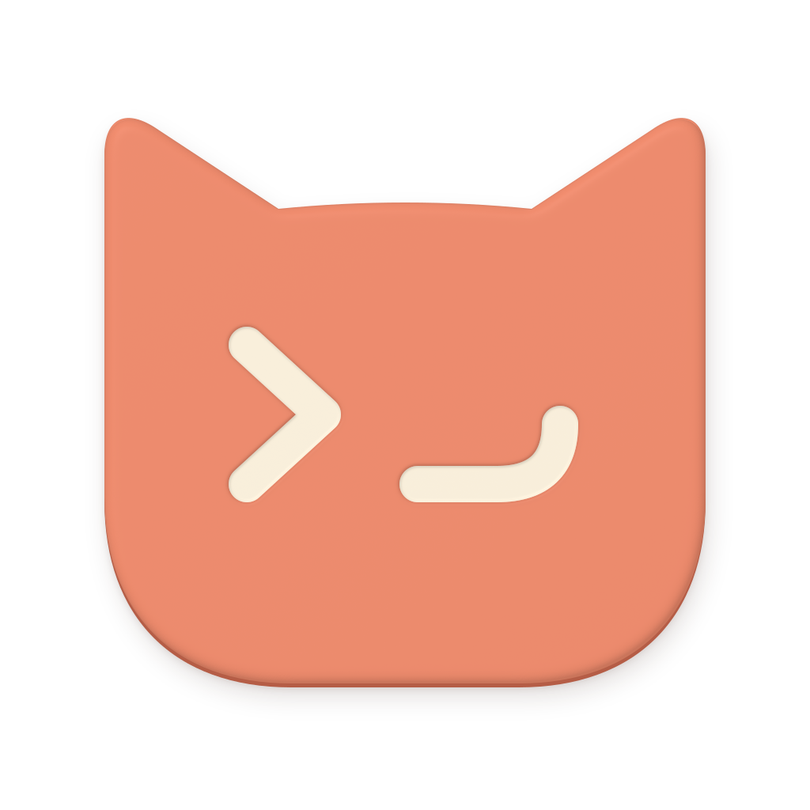
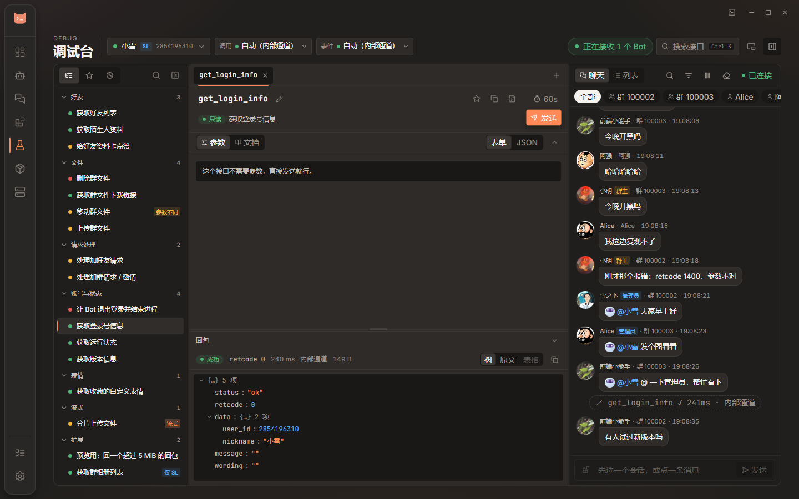
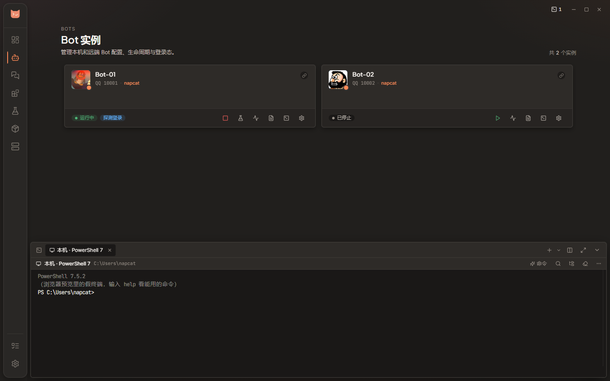

<div align="center">



# NapCatQQ Desktop

**NapCatQQ / SnowLuma 的 Windows 桌面控制台**

从部署 Bot、对接应用端，到聊天、截图和调试，在一个窗口里完成。

[](https://github.com/NapNeko/NapCatQQ-Desktop/releases/latest)
[](https://github.com/NapNeko/NapCatQQ-Desktop/releases)
[](https://github.com/NapNeko/NapCatQQ-Desktop/actions/workflows/ci.yml)
[](LICENSE)
[](https://github.com/NapNeko/NapCatQQ-Desktop/stargazers)

**[项目官网](https://napneko.github.io/NapCatQQ-Desktop/)** · **[下载 Windows 安装包](https://github.com/NapNeko/NapCatQQ-Desktop/releases/latest)** · **[使用文档](https://napneko.github.io/NapCatQQ-Desktop/docs/)** · **[更新日志](https://napneko.github.io/NapCatQQ-Desktop/changelog/)** · **[加入 QQ 群](https://qm.qq.com/q/8UK5ecfDyw)**

[界面预览](#界面预览) · [主要功能](#主要功能) · [安装与开始使用](#安装与开始使用) · [文档](#文档) · [参与开发](#参与开发)

</div>

## 界面预览

**聊天工作区** — 按账号管理会话，在主窗口里聊天，也可弹出独立窗口。


|                     应用端管理                      |                            OneBot 调试台                            |
| :-------------------------------------------------: | :-----------------------------------------------------------------: |
|  |  |
|           管理多个框架的实例、配置和对接            |                  查接口、填参数、看回包与实时事件                   |

<details>
<summary>查看内嵌终端</summary>



</details>

截图来自当前界面的浏览器预览，使用「方正」圆角风格与演示数据。实际功能取决于协议端版本、账号权限与运行环境。

## 主要功能

### 部署与管理 Bot

- **双协议端**：管理 [NapCatQQ](https://github.com/NapNeko/NapCatQQ) 和 [SnowLuma](https://github.com/SnowLuma/SnowLuma)，查看运行状态、登录状态与日志，编辑 OneBot 连接。
- **本机与远端**：本机 Windows 原生运行；通过 SSH 管理远端 Linux，支持原生运行和 Docker 部署。
- **组件安装**：在界面里安装、更新运行时与框架，查看依赖和任务进度；QQ 可单独安装一份，减少对日常使用的系统 QQ 的影响。
- **运行监控**：查看主机 CPU、内存、磁盘及 Bot 指标，配置自动重启、掉线通知；远端可安装 [ncd-watch](https://napneko.github.io/NapCatQQ-Desktop/docs/watch/)，在 Desktop 退出后继续值守。

| 运行位置            | NapCatQQ | SnowLuma |
| :------------------ | :------: | :------: |
| 本机 Windows · 原生 |   支持   |   支持   |
| 远端 Linux · 原生   |   支持   |   支持   |
| 远端 Linux · Docker |   支持   |   支持   |

Desktop 客户端目前面向 Windows x64；Docker 部署面向远端 Linux 主机。本机 Docker 和远端 Windows 不在当前支持范围内。

### 应用端管理与对接

「组件」页负责安装，「应用端」页负责管理实例。可以新建实例或导入已有项目，启停、查看日志、编辑配置，再与 Bot 对接。

| 框架                | 桌面端内的管理能力                       |
| :------------------ | :--------------------------------------- |
| Karin               | 配置编辑、插件管理与 OneBot 对接         |
| NoneBot2            | 适配器、插件商店与连接配置               |
| AstrBot             | 模型提供商、人格、知识库、会话与插件配置 |
| MaiBot（麦麦）      | 深度配置、模型、提示词、学习数据与试聊   |
| Koishi              | 配置表单、插件树与连接管理               |
| TRSS-Yunzai（云崽） | 实例、配置与 OneBot 对接                 |
| NeoBot              | 模型、提示词、记忆、插件、运行与用量面板 |

配置和运行面板按各框架能力提供，部分操作需要实例运行并能连接其 WebUI。**应用端一键对接目前不支持 Docker Bot**，其他对接方式以界面给出的可用选项为准。见 [应用端使用指南](https://napneko.github.io/NapCatQQ-Desktop/docs/apps/)。

### 聊天、媒体与截图

- **私聊与群聊**：每个 Bot 的联系人和消息独立管理，支持好友分组、群消息盒子、置顶、未读筛选和聊天记录搜索。
- **消息操作**：回复、@、撤回自己发送的消息、逐条或合并转发；发送失败可重试，图片和文件可拖入或粘贴到输入框。
- **媒体与群文件**：查看图片、语音、视频、Markdown 和转发记录；群文件支持浏览、上传下载及有权限时的目录和文件管理。
- **原生截图**：默认 `Ctrl+Alt+S`，支持框选、标注、撤销重做、复制、保存和双向滚动长截图。截图可加入聊天草稿，也可设置成只复制，完成后不拉起聊天窗口。
- **账号托盘**：按账号开启后台接收、头像托盘和消息提醒；群聊可单独设免打扰。

聊天与截图可以在「设置 → 功能」统一关闭。后台接收和账号托盘需按账号启用。见 [聊天与截图指南](https://napneko.github.io/NapCatQQ-Desktop/docs/chat/)。

### 调试与运维工具

- **OneBot 调试台**：搜索接口、表单 / JSON 参数编辑、回包查看、实时事件、请求收藏与历史，支持独立窗口。
- **内嵌终端**：本机、远端主机、Bot 和应用端实例都有入口，支持多标签、分屏、文件栏与常用命令。默认 `Ctrl+反引号` 打开。
- **配置备份**：导出 / 导入配置 ZIP，覆盖 Bot、服务器、应用实例、框架配置和界面偏好；导入前校验并备份现有配置。
- **桌面体验**：明暗主题、侧栏样式、托盘、轻量模式和应用内更新。程序与数据分开存放，默认数据根为 `%ProgramData%\NapCatQQ Desktop`，也可从设置中迁移。

## 安装与开始使用

### 下载

1. 打开 [最新 Desktop 发布页](https://github.com/NapNeko/NapCatQQ-Desktop/releases/latest)。
2. 下载 `NapCatQQ-Desktop-<版本>-x64.msi`，或同内容的 `NapCatQQ-Desktop-x64.msi`。
3. 双击安装，启动 NapCatQQ Desktop。

| 项目       | 要求                                                      |
| :--------- | :-------------------------------------------------------- |
| 操作系统   | Windows 10 / 11 x64；Windows Server 2016 及以上           |
| 界面运行时 | Microsoft Edge WebView2，安装包会在缺失时处理安装         |
| 内嵌终端   | 本机终端需要 Windows 10 1809 / Server 2019 及以上         |
| 远端管理   | 可通过 SSH 访问的 Linux 主机；Docker 部署还需 Docker 环境 |

发布名带 `watch-v` 的是远端监控组件，请在「组件」页选择远端主机后安装。更新 Desktop 不会自动替换远端 ncd-watch。

### 第一个 Bot

1. **选运行位置**：本机可直接开始；远端先在「远端」页添加 SSH 主机并测试连接。
2. **准备组件**：在「组件」页选择主机，安装所需的运行时、QQ 与协议端。
3. **创建 Bot**：在「机器人」页新建，选择 NapCat 或 SnowLuma，填写 QQ 号、运行位置和连接配置。
4. **启动并登录**：启动 Bot，按协议端提供的 WebUI 或 QQ 登录入口完成登录，查看卡片状态和日志。
5. **按需扩展**：进入「聊天」，或在「应用端」创建实例并对接；接口问题可从 Bot 卡片进入调试台。

完整步骤与常见问题见 [使用文档](https://napneko.github.io/NapCatQQ-Desktop/docs/)。

### 升级与备份

可以直接安装新版 MSI 覆盖升级，也可从应用内检查更新。升级前建议在「设置 → 数据」导出一份配置 ZIP。

配置包不包含组件程序、插件程序、数据库和聊天消息记录，也不包含系统密钥库中的凭据；配置文件中已有的 token、API Key 等会随原文件保存。迁移到另一台机器时，仍需安装运行环境并核对路径。见 [备份与恢复](https://napneko.github.io/NapCatQQ-Desktop/docs/backup/)。

## 文档

| 要做什么                   | 从这里开始                                                        |
| :------------------------- | :---------------------------------------------------------------- |
| 了解功能、体验交互演示     | [项目官网](https://napneko.github.io/NapCatQQ-Desktop/)             |
| 安装、创建 Bot、备份与排错 | [使用文档](https://napneko.github.io/NapCatQQ-Desktop/docs/)         |
| 管理应用端与 OneBot 对接   | [应用端实例](https://napneko.github.io/NapCatQQ-Desktop/docs/apps/)  |
| 聊天、群文件、截图与托盘   | [聊天与截图](https://napneko.github.io/NapCatQQ-Desktop/docs/chat/)  |
| 部署远端 Linux             | [远端管理](https://napneko.github.io/NapCatQQ-Desktop/docs/remote-linux/) |
| Desktop 关闭后继续远端值守 | [ncd-watch](https://napneko.github.io/NapCatQQ-Desktop/docs/watch/)   |
| 查看版本更新               | [更新日志](https://napneko.github.io/NapCatQQ-Desktop/changelog/)    |
| 阅读或修改代码             | [贡献指南](CONTRIBUTING.md) · [代码地图](docs/context/codemap.md) |
| 查找其他文档               | [文档索引](docs/README.md)                                        |

## 参与开发

技术栈为 **Rust + Tauri 2 + React + TypeScript**，界面使用 Tailwind CSS 与 Radix UI。Windows 开发环境准备、检查命令、架构约定和 PR 说明见 [CONTRIBUTING.md](CONTRIBUTING.md)。

```powershell
git clone https://github.com/NapNeko/NapCatQQ-Desktop.git
cd NapCatQQ-Desktop
pnpm.cmd install --frozen-lockfile
pnpm.cmd run tauri:dev
```

只看界面可运行 `pnpm.cmd run dev`，打开 `http://localhost:1420`。浏览器预览使用演示数据，真实 Bot、SSH、原生截图和终端需在 Tauri 应用中验证。

当前维护主线为 `main`；旧 Python / PySide6 实现保留在 [`v1`](https://github.com/NapNeko/NapCatQQ-Desktop/tree/v1) 分支。

## 反馈与社区

- **问题与建议**：[GitHub Issues](https://github.com/NapNeko/NapCatQQ-Desktop/issues)。请附 Desktop 版本、协议端版本、运行方式、复现步骤和相关日志；贴出前隐藏 token、密码及密钥。
- **交流**：[加入 QQ 群](https://qm.qq.com/q/8UK5ecfDyw)。
- **协议端文档**：[NapCat 文档](https://napneko.github.io/) · [SnowLuma](https://github.com/SnowLuma/SnowLuma)。

## 致谢

感谢 [NapCatQQ](https://github.com/NapNeko/NapCatQQ)、[SnowLuma](https://github.com/SnowLuma/SnowLuma)，以及 Tauri、Rust、React 和各应用端框架的开发者，也感谢提交 Issue、PR 和参与测试的朋友。

<a href="https://github.com/NapNeko/NapCatQQ-Desktop/graphs/contributors">
  
</a>

> ### 🙏 特别鸣谢
>
> [Futureppo](https://blog.futureppo.top/) 为本项目提供了大量的 AI Token 支持，助力开发进程。感谢他的慷慨赞助！
>
> [](https://blog.futureppo.top/)

## 许可

本项目采用 [GPL-3.0 许可证](LICENSE)。
