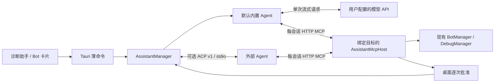

# 内置 Agent 诊断助手

诊断助手默认使用 NCD 内置 Agent，为选中的 Bot 注入现场并通过受限 MCP 调用运维工具。内置模式直接使用用户配置的模型接口，外部 ACP Agent 保留为可选入口。

## 功能闭包

| 层 | 落点 |
| --- | --- |
| IPC 模型 | `crates/ncd-domain/src/assistant.rs`，ts-rs 生成 `Assistant*.ts` |
| 宿主契约 | `crates/ncd-traits/src/assistant.rs` |
| 会话管理 | `crates/ncd-runtime/src/assistant.rs` 与 `assistant/` |
| 内置模型与循环 | `assistant/builtin/{model,stream,turn,history,mcp}.rs`，`model/sdk/` 接 rust-genai，`builtin_connection.rs` 接入现有会话 |
| 模型 SDK | `vendor/genai/` 固定 0.7.1，升级和传输校验补丁见其 `UPSTREAM.md` |
| 模型配置与密钥 | `assistant/settings.rs`、`credentials.rs`；系统 SecretStore，不写入设置或档案 |
| 会话 MCP | `crates/ncd-mcp/src/assistant.rs` 与 `assistant/` |
| 桌面接线 | `src-tauri/src/commands/assistant.rs`、AppState、退出与数据根迁移收尾 |
| 前端 | `core/domain/assistant` → `core/services/assistant.service.ts` → `hooks/assistant` → `modules/assistant` |

## 内置模式

模型设置包含服务商预设、API 格式、Base URL、模型标识和步骤 / 输出 / 超时预算。支持 OpenAI Chat Completions、OpenAI Responses、Anthropic Messages、Gemini GenerateContent，协议由 `apiFormat` 明确指定，不按模型名猜测。

预设涵盖自定义、OpenAI、Anthropic、Gemini、DeepSeek、MiniMax、Moonshot/Kimi、阿里云百炼、OpenRouter 和本机 Ollama。选择预设会带出推荐协议，空地址或前一个预设的默认地址随之替换；手填地址和模型保留。模型示例需用户主动选择，不请求模型列表。旧配置缺少新字段时默认自定义 Chat Completions，保留地址、模型和现有凭据。

服务根地址按所选格式补路径；Chat、Responses、Anthropic 的 `/v1` 前缀分别追加 `/chat/completions`、`/responses`、`/messages`，Gemini 使用模型资源和 `alt=sse`。在界面明确切换格式时，原格式的标准终点随之替换，自定义路径前缀保留；其他完整路径不猜测或改写。仅接受 HTTPS 或本机 HTTP，不接受 URL 账号、查询参数或片段。保存、读取状态和创建会话不调用模型。

API Key 由主窗口单次提交到系统凭据存储，按规范化接口 origin（scheme、host、port）分开保存。输入时绑定来源，跨来源切换清空未提交 Key；写入或清除时后端在设置锁内核对 `expectedOrigin`，拒绝旧面板修改新来源的凭据。设置、会话档案、前端共享草稿、缓存和事件不包含 Key。界面只返回已配置状态；不提供读回 Key 的命令，不使用文件降级存储。保存或清除 Key 时先停止内置会话、等待取消结算和持久化，再更新凭据，保留可恢复历史。本机 Ollama 预设且地址为回环时可不填 Key；远端地址仍需 Key。

内置循环串行执行已完整校验的工具调用，保存完整调用 ID、参数与结果，不使用界面截断后的工具详情当作模型历史。历史按完整旧轮次裁剪，工具提交前和每项结果后等待 checkpoint。取消、预算用尽或请求错误时，为未完成调用补上明确的未知 / 未执行结果；不会自动重放操作。

模型请求不自动重试、不跟随重定向，不在失败后切换地址、协议或模型。接口需支持 SSE 流式响应；忽略流式参数而返回普通 JSON 时明确失败，不再次发起请求兜底。SSE 需明确结束，工具参数按 index 汇总并在完整 JSON、调用 ID、工具名和参数约束校验后执行。仅展示正常回答，不展示模型推理原文。文本、工具参数、目录、响应、步骤与时间均有上限；已知模型 Key 和会话 Bearer 在流式显示及私有历史中脱敏。

`minimax-m3.1-flash` 使用拆分思考、低思考预算与 `max_completion_tokens`。工具续轮所需的 `reasoning_content` 和原始 assistant content 仅保留在私有协议历史中，精确脱敏凭据后完整回传；不进入 IPC、工具详情或日志。旧档案缺少该字段时保持兼容。

rust-genai 仅替换协议编解码。四种格式的工具调用仍先完整校验，再由原来的循环调用会话 MCP；协议专属推理、签名和原生响应项仅进入脱敏的私有历史，不回传 UI。切换协议时，旧协议的调用和结果转为普通历史文本，私有推理与签名不进入新协议；当前协议的新调用继续保留原生续轮信息。`ask_user` 复用桌面追问，拒绝索取密码、密钥和令牌；其他工具沿用下文 MCP 范围，内置模式不会扩大文件、终端、QQ 或 SSH 权限。

模型 HTTP client 单独配置既有 ring 与平台证书验证，通过 SDK 的 `rustls-tls-no-provider` feature 接入；不依赖 AWS-LC 本机构建，也不安装进程默认 provider。预配置 TLS 显式保留 HTTP/2 和 HTTP/1.1 的 ALPN。

## 外部 Agent 入口与工具权限

预置 DSH、Qwen Code、Kimi Code、MiniMax Code、CodeBuddy、Qoder、TRAE，以及自定义 ACP 程序。发现仅检查 PATH 和已知安装位置，不递归扫描用户文件。版本探测最多两路并发、五秒，输出最多 4 KiB。

DSH、Qwen、Kimi、MiniMax 的受限配置按已核对版本启用；未知版本会明确要求更新适配，或由用户在高级设置中允许 Agent 的原生工具。自定义程序只接受绝对可执行路径和独立 argv，不执行任意 shell 命令或未知脚本包装器。

DSH 0.2.0-rc.2 的 ACP 入口没有 `--model` / `-m` 参数；本轮沿用其 ACP 默认模型路由 `deepseek-official`，这是 API Key 路由，与网页登录账号路由不同。NCD 不自动切换模型或认证路由。Kimi 返回 ACP `-32000` 时提示用户在 Kimi 中检查认证状态，不从本机凭据文件推断登录情况。

受限模式使用会话专用工作目录，不改写 Agent 全局配置。关闭 ACP 的文件和终端回调只是协议能力限制，不是操作系统沙箱。允许原生工具时，Agent 自带工具仍受它自身的权限机制控制。

MiniMax 受限配置需要独立 data-dir，认证信息不会从用户全局目录复制。用户可在会话里点击登录，通过现有可见终端完成 OAuth；该目录在写入配置前设置为私有。NCD 不解析登录凭据。浏览器预览不执行登录命令、调用模型或操作 Bot。

## 会话与交互

- 新建页选择 Bot 与助手后直接发送首条问题；内置模型尚未配置时，可在页内一次保存地址、模型与 Key。外部 Agent 从助手菜单按需检测，完整配置放在助手设置中。
- 连续工具调用折叠展示；仅当前轮次的工具显示运行状态。发送期间允许继续写草稿，发送完成、失败或创建后补读失败都不会丢失尚未发送的问题。
- 每轮问题前加入固定诊断说明和现场；用户文本不会作为 CLI 斜杠命令执行。
- 页面切换和轻量模式不结束 Agent；停止会撤销本轮交互与 MCP，回收进程，并保留可恢复的会话。
- 按 Agent 协商结果使用 `session/resume` / `session/load`；不支持或原会话不可恢复时，新建 Agent 会话并补充有界可见历史。
- 加载期间立即消费 Agent 通知，避免恢复历史阻塞握手；NCD 使用自己的档案显示历史。
- 消息、工具输出、队列、反向请求、档案和会话数量均有上限；stderr 不直接进入界面或档案。
- 权限与表单请求绑定连接代次，取消、超时、断线和请求 future 被丢弃都清理交互。旧审批不能批准新的轮次。
- 事件带版本、会话编号和序号；快照带水位，前端丢序号时补读，并只重放水位之后的事件。
- 关闭释放 Agent，删除仅移除 NCD 的主会话档案；配置存储的有限备份遵循原有保留策略。Agent 自身历史、专用工作目录和登录信息不会自动递归清理。

## MCP 边界

助手不打开全局 MCP 设置、不复制其长期令牌。每个会话使用独立回环端口与随机凭据，由后端 MCP 客户端使用；外部 Agent 仅通过 ACP 的 HTTP headers 接收，不进入提示词或 IPC。连接与退出立即撤销凭据，近期已撤销凭据继续参与有界脱敏。

工具目录收窄为当前 Bot 的运行摘要、缓存日志、通道、动作说明和健康检查。禁止跨 Bot、覆写协议类型、任意文件、凭据、调用方确认令牌以及未经审核的 OneBot 动作。共享 SnowLuma 守护进程日志无法按 Bot 隔离时明确不可用。关联应用只投影名称、框架与状态。

`start_bot`、`stop_bot`、`restart_bot` 需要桌面本次 `allow_once`。批准绑定目标和动作，执行前再次核对目标配置、Desktop 协议和数据根迁移门禁；Agent 提交的确认字段不构成人工批准。

取消或超时不等于撤销已经提交给 BotManager 的操作，返回结果要求先核实状态，避免盲目重试。

## 验证层级

协议测试覆盖内存状态及真实 Node 假 Agent 子进程；后者显式忽略，需 `--include-ignored` 运行。MCP 测试使用临时数据根和计数后端，不连接 QQ 或真实主机。前端 mock 只用于浏览器交互和视觉验收。

这些测试与实际 Agent 握手、真实模型调用、真实 Bot 恢复是不同层级，交付记录须分别说明证据，不能互相替代。

内置模型的验证使用本地假 HTTP / SSE 与真实 Manager 集成测试，覆盖完整工具历史、权限和参数、取消、Key 更新、失败不重试和无探测。真实接口仅在本地检查结束后运行“了解当前环境”任务，接口不可用即停止，不使用 `hi` 或其他测活提示。

内置真实任务入口：`cargo run -p ncd-mcp --example assistant_builtin_environment`。从 `NCD_ASSISTANT_TEST_BASE_URL`、`NCD_ASSISTANT_TEST_MODEL`、`NCD_ASSISTANT_TEST_API_KEY` 读取临时配置，Key 仅在内存 SecretStore，档案在临时目录；只提供读取真实开发环境元数据的 `diagnose_bot`，不接真实 Bot。不会自动发现模型或重试接口请求。

### rust-genai 与模型配置本地验证记录（2026-10-27）

- 169 项 runtime、9 项 MCP 和 3 项 domain 兼容测试通过；全项目 652 项绑定导出通过，含 25 项 Assistant 类型。包含四种协议、完整结束门控、工具续轮、跨协议历史降级、Gemini 无 ID 工具跨轮 / 跨帧唯一性、取消及凭据来源竞态。
- SDK 的 24 项本地 webc 测试通过，覆盖缓冲前的总量 / 帧体积限制、截断流、失败 HTTP 不保留正文、敏感 Header 和拆分 CRLF。
- 前端 12 个文件、115 项相关测试，类型检查、范围内 lint / 格式检查与生产构建通过；`node scripts/build-remote-agent.mjs`、`cargo check --workspace --all-targets` 通过。改动 Rust 和 vendor 全部格式检查通过；全库 `cargo fmt --all -- --check` 仍有 Karin、终端、截图等未改动文件的存量格式差异。
- 桌面浏览器 mock 完成十种预设、四种格式、地址联动、换源清空未提交 Key、本机 Ollama 免 Key、一次保存和重新打开设置的走查。未测试窄屏，未调用真实模型或操作真实 Bot。界面无 console error；从概览导航时出现其既有 GSAP rotate 重置警告。
- Windows 实际开发启动补充：默认 `target` 的 Low 完整性标签使构建脚本、测试和桌面程序无法写普通 Temp / 日志，复现 `LNK1104` 与访问拒绝。同一批新测试二进制复制到普通完整性目录后，169 runtime、9 MCP、28 domain / Assistant 绑定全部通过。`tauri:dev` 现通过 `scripts/tauri-dev.mjs` 自动选择工作区外的独立缓存；3 项入口测试和原 CLI 参数转发检查通过。原命令热启动的远程 Agent 构建 1.49 秒、桌面构建 21.15 秒，原生 AX 确认真正的 Tauri 概览完成加载；未做像素验收或真实模型调用。

### 内置模式本地验证记录（2026-10-25）

- 152 项 runtime、9 项 MCP 相关测试通过，含真实子进程 ACP 兼容、本地 HTTP / SSE、工具结果续轮、私有推理回传、凭据更新与流中断 / 取消脱敏。
- 23 项 Assistant IPC 类型导出测试通过；前端 11 个文件、67 项测试，类型检查、范围内 lint / 格式检查及生产构建通过。
- `node scripts/build-remote-agent.mjs` 与 `cargo check --workspace --all-targets` 通过。本机 pnpm 自动版本切换下载失败后使用同等命令完成检查，未修改包管理配置。
- 专用浏览器完成默认内置配置门控、模型 / Key 保存、创建、工具展示、审批、追问、停止恢复、Key 更新后断开且历史保留、外部 Agent 折叠选择及 420px 布局走查；无浏览器错误。仅使用 browser mock，截图在本机 `tmp/assistant/builtin/`，专用浏览器与 Vite 已关闭。
- 使用用户给定配置执行一次“了解当前环境”真实任务，首个模型请求收到 HTTP 400，未进入工具调用。依照用户要求立即停止，未测活、查询模型列表、重试、更换模型或调整参数再发请求。上游响应正文未进入日志；无法据此判定拒绝原因，真实模型闭环未通过。验证进程已退出，临时 Key 与监听已清理，未操作真实 Bot。

### 此前外部 ACP 验证记录（2026-10-25）

- 92 项后端相关测试通过（runtime 83、MCP 9），包含真实 Node 假 Agent、Windows 进程树回收、目录 ACL、会话竞态与范围隔离。
- 21 个 Assistant IPC 类型导出测试通过；前端 39 项相关测试、类型检查、生产构建和范围内 lint / 格式检查通过。
- workspace all-targets check 通过。独立无头浏览器完成创建、审批、追问、停止恢复、草稿保留及 420px 设置保存；截图在本机 `tmp/assistant/`。测试浏览器及 Vite 已关闭。

| 本机 Agent | 实际结果 |
| --- | --- |
| DSH 0.2.0-rc.2 | 真实 ACP 会话、HTTP MCP initialize 和 tools/list 通过；修复 Node 不接受扩展前缀脚本参数的问题。模型请求返回余额相关上游错误，未产生工具调用或 canary 答案 |
| Kimi Code 2.1.1 | 真实 ACP 握手完成，session/new 返回需认证 `-32000`，未进入模型轮次 |
| Qwen Code、MiniMax Code | 受限配置及发现逻辑已有自动化覆盖；本机未安装，未做真实 Agent / 模型验收 |
| CodeBuddy、Qoder、TRAE、自定义 ACP | 预置协商入口与设置；需显式允许原生工具，本轮未做真实 Agent 验收 |

未执行真实 QQ、SSH 或 Bot 启停。模型调用、实际工具结果复述和真实 Bot 恢复仍需在 Agent 认证及额度可用的环境验收。

合成联调入口是 `crates/ncd-mcp/examples/assistant_agent_smoke.rs`：`cargo run -p ncd-mcp --example assistant_agent_smoke -- --provider dsh` 仅握手和发现；加 `--with-model` 才发送合成问题，要求实际读取唯一只读工具中的随机 canary。输出限于阶段、计数与固定错误类别，不打印 Agent 原始错误或凭据。

## 上游接口

内置实现参考 OpenCode 提交 `a41d09bc` 的工具流汇总、多步循环、步数预算与统一取消，采用 Rust 实现并复用 NCD 授权边界，不引入 OpenCode 产品运行时。

- [OpenCode 工具参数流](https://github.com/anomalyco/opencode/blob/a41d09bc78e2cda3201096bf766ef3a2c359d54b/packages/ai/src/protocols/utils/tool-stream.ts)
- [OpenCode 会话循环](https://github.com/anomalyco/opencode/blob/a41d09bc78e2cda3201096bf766ef3a2c359d54b/packages/core/src/session/runner/llm.ts)
- [MiniMax OpenAI-compatible 接口](https://platform.minimax.io/docs/api-reference/text-openai-api)

- [ACP v1](https://agentclientprotocol.com/protocol/v1/overview)
- [DSH](https://github.com/deepseek-ai/deepseek-harness)
- [Qwen Code](https://github.com/QwenLM/qwen-code)
- [Kimi Code](https://github.com/MoonshotAI/kimi-code)
- [MiniMax Code](https://github.com/MiniMax-AI/minimax-code)
- [Kimi ACP 认证语义](https://github.com/MoonshotAI/kimi-code/blob/main/docs/en/reference/kimi-acp.md)
- [DeepSeek API 错误码](https://api-docs.deepseek.com/zh-cn/quick_start/error_codes/)
