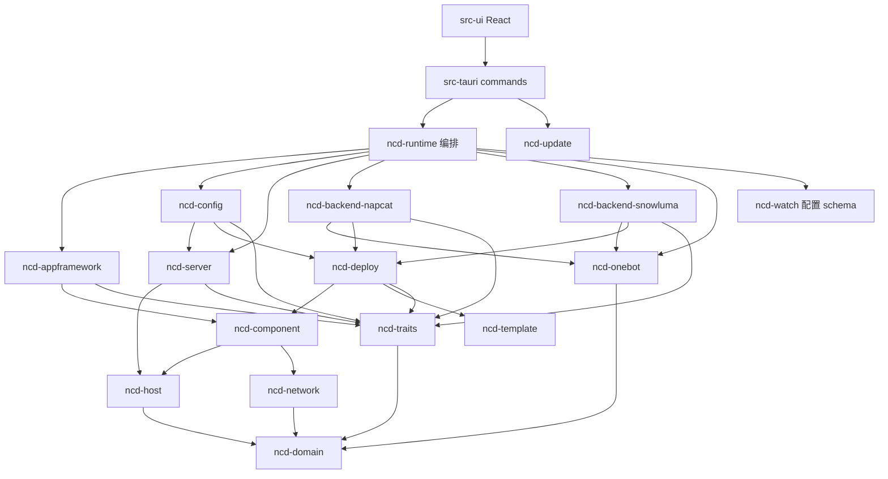

# Codemap — 功能域 → 代码落点

> 接手任务先查这张表锁域，再在闭包内搜/改。  
> 生成：2026-07-09 | 路径最近一次逐条核对：2026-09-29（`4eb35382`） | 主体迁移已完成  
> 旧 Python 对照根：**`.references/NapCatQQ-Desktop-main`**（不是 `legacy-python/`）

## 怎么用

1. 用业务关键词在下表找到 **域**。
2. 只打开该域「主路径」+「相关入口」；不要无理由全库扫。
3. NC/SL 启停/登录/WebUI/远端语义先读 `.claude/kb/INDEX.md`。
4. 跨边界类型：Rust `ts-rs` → `src-ui/core/ipc/generated/**`，前端只 re-export。



图里只画主要的边：除 ncd-log / ncd-template 这几个无内部依赖的 crate，其余都直接依赖 ncd-domain；runtime 也直接用 host / component / deploy / network / log。两个 `ncd-backend-*` 互不依赖。

---

## 总览：仓库布局

| 路径 | 职责 |
|------|------|
| `crates/ncd-domain/` | Layer1 强类型模型、事件 payload、配置/ID/错误；跨 IPC 的类型大多在这里派生 ts-rs（`ComponentId` 与依赖图、`LogSnapshot`、应用端实例 / 配置错误…） |
| `crates/ncd-traits/` | Layer2 契约：BotBackend、ConfigStore、EventBus、SecretStore、AppIntegration… |
| `crates/ncd-runtime/` | Layer3 编排：BotManager、AppManager、ComponentExecutor、TerminalManager、DeploymentTaskManager，域目录 bootstrap/launch/remote/…；config/server re-export |
| `crates/ncd-config/` | 配置横切：store/drift/migration/secret/path/discovery（runtime re-export 兼容） |
| `crates/ncd-server/` | 远端主机档案 / 凭据 / SSH 密钥 / HostResolver（runtime re-export 兼容） |
| `crates/ncd-backend-napcat/` | NapCat 本机+远端实现（WebUI/login poller/remote native） |
| `crates/ncd-backend-snowluma/` | SnowLuma daemon/poller + remote stack/tunnel |
| `crates/ncd-onebot/` | OneBot 11 调试台协议层：动作目录（NapCat / SnowLuma 两种文档统一模型 + 内置快照）、HTTP / WS / SSE 客户端、重连退避、事件环形缓冲；只依赖 ncd-domain，不认识 Bot 和 Tauri |
| `crates/ncd-host/` | 本机 Windows / Linux、远端 Windows / Linux SSH 主机抽象；本机平台工厂在 `local::local_host`，Linux 进程组与 PTY 在 `local/{linux,pty_linux}.rs`；Windows PowerShell 字节流、SFTP、PTY、隧道和平台探测在 `remote/windows*`；Linux 包管理器 `LinuxPackageManager`、远端读文件 `remote_file` 都在这层 |
| `crates/ncd-agent/` | Windows SCM 控制服务、认证 Named Pipe、独立 Job runner、所属用户会话 worker；`bot/` 托管 NC/SL，`watch.rs` 承载同一值守引擎。协议在 `ncd-domain/windows_remote.rs`、`windows_bot.rs`，Desktop 路由在 `ncd-runtime/launch/windows*`。用户入口见 [Windows 远程管理](../user/windows-remote.md) |
| `crates/ncd-watch/` | 远端主机侧监控 bin：探活 + Webhook（Desktop 退出后） |
| `crates/ncd-component/` | 组件：Node/uv/QQ/NoVnc/NapCat/SnowLuma/DesktopSelf/NcdWatch；`ComponentId`（含按实例装的 Karin / NoneBot2 / AstrBot / MaiBot / Koishi）定义在 ncd-domain，这里转出 |
| `crates/ncd-appframework/` | 应用端框架适配器：registry + `karin/`、`nonebot2/`、`astrbot/`、`maibot/`、`koishi/`（manifest / Component / Integration / 写配置备份还原），共用的挑口查口 `ports.rs` |
| `crates/ncd-deploy/` | 部署计划、Docker/Native、配置渲染、RemoteQq 协调 |
| `crates/ncd-network/` | HTTP/下载/代理等 |
| `crates/ncd-update/` | 应用自更新 |
| `crates/ncd-log/` | 日志设施 |
| `crates/ncd-template/` | compose/模板生成 |
| `crates/ncd-test-support/` | 测试 fixture / mock |
| `src-tauri/` | Tauri 薄壳：bootstrap、commands、tray、lightweight |
| `src-ui/` | React UI：app / modules / hooks / core / shared |
| `.references/NapCatQQ-Desktop-main/` | 旧 PySide6 实现（只读对照） |
| `.references/SnowLuma/`、`NapCatQQ/` 等 | 上游/周边参考（只读） |
| `.claude/` | 本地 AI 状态/KB/plan（gitignore） |
| `docs/context/` | 给人/Agent 的活上下文：本 codemap、后端能力速查 `capabilities.md`、前端分层 `frontend.md`、踩坑 `lessons.md` |
| `docs/dev/` | 架构/归档（本地，gitignore） |

---

## 域表

### 1) 应用启动 / 数据根 / Bootstrap

| 关注点 | 主路径 |
|--------|--------|
| 数据根解析 | `src-tauri/src/bootstrap.rs`（`resolve_data_root`：Windows 为 `NCD_DATA_ROOT` → **HKCU** DataRoot → **HKLM** DataRoot → ProgramData；Linux 为 `NCD_DATA_ROOT` → XDG 配置目录迁移指针 → XDG 数据目录） |
| 产品路径注册表 | `src-tauri/src/product_registry.rs`（HKLM 机器默认 + **HKCU 用户迁移指针** `write_user_data_root`）+ `src-tauri/wix/v2-orphan-cleanup.wxs`（HKLM DataRoot 机器默认；WiX3 无 NeverOverwrite）+ `src-tauri/wix/main.wxs`（HKCU `Software\NapCatQQ Desktop`；模板须 `Software\\{{product_name}}`）+ `legacy_install_cleanup.rs` |
| 数据根整树迁移 | `crates/ncd-runtime/src/data/relocate.rs` + `ncd-domain` `data_root_migrate.rs` + `src-tauri/src/commands/data_root_migrate.rs` + UI `DataRootMigrateDialog` / `DataTab`；活 plan `.claude/plan/data-root-relocate.md` |
| 下载缓存清理 | `ncd-runtime/src/data/{cache,cache_fs}.rs` + `ncd-domain/src/cache_cleanup.rs` + `commands/cache_cleanup.rs` + UI `CacheCleanupDialog` / `useCacheCleanup`；`ComponentExecutor` 持有共享服务，安装/更新持读租约至整个任务结束，清理/迁移持独占租约；Windows 以 `tmp/.ncd-download-cache.lock` 的共享模式保护同数据目录的其他实例；新缓存通过 `DataPaths` 落 `cache/{installers,updates,downloads}`，历史路径按白名单扫描 |
| 启动快照 | `src-tauri/src/bootstrap.rs` + `ncd-domain` `bootstrap.rs` |
| App 组装 / AppState | `src-tauri/src/lib.rs` |
| 运行时句柄 | `src-tauri/src/runtime.rs` |
| 前端启动门 | `src-ui/app/AppBootGate.tsx`, `StartupSplash.tsx`, `AppProvidersNext.tsx` |
| 前端 bootstrap 服务 | `src-ui/core/services/bootstrap.service.ts` |
| hooks | `src-ui/hooks/bootstrap/` |
| domain 模型 | `src-ui/core/domain/bootstrap/` |
| 配置迁移 / 旧目录发现 | `ncd-config`（migration/app/bot/legacy_discovery/path_probe）；server profile 在 `ncd-server`；runtime 旧路径 re-export |
| Desktop 用户协议 / 隐私 | `src-tauri/legal/{EULA,PRIVACY}.md` + `src-tauri/src/desktop_consent.rs` + `commands/desktop_consent.rs`；前端 `desktop-consent.service.ts` / `useDesktopConsentGate` / `DesktopConsentDialog`；**启动进主界面即 gate**（不同意退出）；`start/upsert/batch_start` command 强制 `ensure_accepted`（`DESKTOP_CONSENT_REQUIRED`）；未同意时 bootstrap 跳过 auto_start；同意落 `data_root/config/desktop-consent.json`；**同意键 = 各文档声明版本**（`eula@1.3+privacy@1.2`，改正文不升版则不重弹），正文归一化换行后再算 `contentHash`（只记录，不判定），旧 content-hash 记录（LF/CRLF 两种）仍视为已同意；正文与指纹进程内 OnceLock 缓存 |
| 新手引导（可选） | `src-tauri/src/desktop_onboarding.rs` + `commands/desktop_onboarding.rs`；前端 `desktop-onboarding.service.ts` / `useOnboardingGate` / `OnboardingDialog` / `onboardingHost`；**consent 通过后**弹「了解 / 跳过」（门禁式，无 X）；设置·关于「重新查看入门」；**只认** `data_root/config/desktop-onboarding.json` 的 status，不探测 bot.json |
解析：`NCD_DATA_ROOT` → `HKCU\SOFTWARE\NapCatQQ-Desktop\DataRoot`（用户迁移，无 UAC）→ `HKLM\…\DataRoot`（MSI 机器默认；启动缺键补写；用户权威在 HKCU）→ ProgramData。业务模块禁止硬编码 ProgramData/LocalAppData。整树换根 ≠ layout 收敛（后者见 `data/consolidate.rs`）
权威数据根默认：`%ProgramData%\NapCatQQ Desktop`。Windows 生产以 `HKLM\SOFTWARE\NapCatQQ-Desktop\DataRoot` 为准（MSI 写入；启动缺键补写；后续可迁移改指针）；`NCD_DATA_ROOT` 环境变量可覆盖。业务模块禁止硬编码 ProgramData/LocalAppData。

Linux 默认数据根为 `$XDG_DATA_HOME/NapCatQQ Desktop`（未设置时 `~/.local/share/NapCatQQ Desktop`），迁移指针在 XDG 配置目录的 `NapCatQQ Desktop/data-root.json`。组件统一落在数据根的 `components` 下，Linux QQ / NapCat 使用 `ncd-domain::remote_paths` 的注入式相对路径，消费方通过 `DataPaths` 取值。


---

### 2) Bot 生命周期（启停/重启/状态）

| 关注点 | 主路径 |
|--------|--------|
| 编排核心 | `crates/ncd-runtime/src/bot_manager/`（`mod.rs` 持有依赖与路由，`start.rs` 启动/重启，`configuration.rs` 保存/移除，`hot_reload.rs` 派生配置，`bootstrap.rs` 恢复，`queries.rs` 查询，`shutdown.rs` 退出，`local_metrics.rs` 独立完成本机探针文件准备，`start.rs` 应用启动环境，`metrics.rs` 同步运行中指标；生产子模块显式导入依赖，单模块辅助函数保持私有；helpers / listeners / `auto_restart.rs` 保留各自职责；启动预检接口 `runtime_gate.rs` 的 `RuntimeReadinessGate`，实现是 `components/readiness_gate.rs` 的 `ComponentRuntimeGate`） |
| 路由 NC/SL × Local/Server × Native/Docker | `crates/ncd-runtime/src/launch/router.rs` + `bot_manager` `backend_for_config`；远端选中路径取自组件执行器那份 `RemoteInventoryService`（`BotManager::with_remote_inventory`） |
| Actor 状态机 | `crates/ncd-runtime/src/bot_actor.rs` + `ncd-domain/bot_actor.rs` |
| 本机启动计划 | `crates/ncd-runtime/src/launch/plan.rs` |
| Docker 会话（隧道/日志/poller） | `crates/ncd-runtime/src/remote/docker_session.rs`；NapCat WebUI token 以容器 `/app/napcat/config/webui.json` 为准（`docker_helpers::read_napcat_docker_webui_token`），日志出现新 token 或鉴权被拒时重读（`remote/docker_webui_token.rs`） |
| 远端 runtime 会话表 | `crates/ncd-runtime/src/remote/runtime_sessions.rs` |
| 远端日志 follow | `crates/ncd-runtime/src/remote/bot_log_follow.rs` |
| 冷启动 reconcile | `crates/ncd-runtime/src/bootstrap/reconcile.rs` |
| 原生部署适配 | `crates/ncd-runtime/src/native_deployment_adapter/` |
| Tauri commands | `src-tauri/src/commands/bot.rs` |
| 前端页 | `src-ui/modules/bot/BotPage.next.tsx`, `list/`, `log/`, `dialogs/` |
| 前端服务/hooks | `src-ui/core/services/bot.service.ts`, `src-ui/hooks/bot/` |
| 配置模型 | `crates/ncd-domain/src/bot_config.rs`, `runtime_scenario.rs` |
| 服务器间整套迁移 | `ncd-domain/bot_migration.rs` → `app_framework/manager/bot_migration/` + `bot_migration.rs` / `migration_apps.rs` / `migration_transfer.py`；协议端停止核实和租约 `bot_manager/migration.rs`；薄壳 `commands/bot_migration.rs`；UI `BotMigrationDialog` / `useBotMigration`；使用说明 [bot-migration.md](../user/bot-migration.md) |
| BotBackend trait | `crates/ncd-traits/src/runtime_backend.rs` |

KB：`.claude/kb/desktop-routing.md`, `nc-vs-sl.md`

---

### 3) NapCat 后端

| 关注点 | 主路径 |
|--------|--------|
| crate 入口 | `crates/ncd-backend-napcat/src/lib.rs` |
| WebUI 客户端 | `.../napcat/webui_client/`（trait / client / payloads / error） |
| 登录轮询 | `.../napcat/login_poller/`（loop / transitions / types / backoff + 测试）；换凭据失败退避，原因经 `napcat_webui_auth_changed` 推给徽章 |
| webui.json 解析 | `.../napcat/webui_config.rs` |
| 端点表 | `.../napcat/endpoint_table.rs` |
| 离线通知 | `.../napcat/offline_notifier.rs` |
| 远端 NapCat session | `.../remote_native_napcat_session/`（含 `launch.rs` 启动规划） |
| runtime re-export | `crates/ncd-runtime/src/napcat/` |
| 事件原因类型 | `crates/ncd-domain/src/napcat_events.rs` |

旧对照：`.references/NapCatQQ-Desktop-main/src/core/runtime/`（napcat driver 等）

KB：`.claude/kb/napcat-runtime.md`

---

### 4) SnowLuma 后端

| 关注点 | 主路径 |
|--------|--------|
| crate 入口 | `crates/ncd-backend-snowluma/src/lib.rs` |
| 本机 daemon / session / poller | `.../snowluma/daemon.rs`, `session.rs`, `status_poller/` |
| WebUI 客户端 | `.../snowluma/webui_client/` |
| 进程树 / login probe | `.../snowluma/proc_tree.rs`, `qq_login_probe.rs`, `linux_proc_probe.rs` |
| 本机 runtime backend | `.../snowluma/runtime_backend.rs` |
| 远端 backend 总装 | `.../remote_snowluma/`（backend/daemon/inject/config/helpers） |
| 远端启动缓存与释放 | [SL 启动缓存生命周期](sl-startup-cache-lifecycle.md)：初始化槽、连接代、身份指纹、Bot 租约与隧道 |
| 扫码登录 | 远端 `.../remote_snowluma/login_helper.rs` / `.../docker_login.rs` + `resources/login-helper/atspi-login.py`（短期 AT-SPI / X11、PID/starttime/UID/display绑定）；Windows `.../snowluma/windows_qr_login.rs`（UIA） / `windows_qr_capture.rs`（WGC 单帧） + `runtime_backend.rs`；`qr_guard.rs`（SL 显式状态与账号门控）→ `ncd-domain/src/snowluma_login.rs` / `ncd-traits/BotBackend` → `ncd-runtime/src/bot_manager/qr_login.rs` → `commands/snowluma.rs`；Docker 复用 `remote/docker_session.rs` 已认证 client；UI `useRemoteSnowlumaQrLogin` / `RemoteSnowLumaQrLoginDialog`；本机与远端独立开关，默认开启、显式关闭保留、冷启动生效，保留 QQ / VNC 回退 |
| 远端编排 / 栈 / 布局 / 隧道 / 日志 | `.../remote_snowluma/{orchestrator,stack,layout,tunnel,log}.rs`；远端 bash 路径 `remote_bash.rs`（经 `Host::which` 按连接记住，不放进程级 static） |
| 协议同意 / consent 文件 | `crates/ncd-runtime/src/snowluma/{agreements,consent_files}.rs` |
| Tauri SL 命令 | `src-tauri/src/commands/snowluma.rs` |
| 前端服务 | `src-ui/core/services/snowlumaApp.service.ts` |
| domain | `ncd-domain/daemon_state.rs`, `snowluma_start_mode.rs` |

KB：`.claude/kb/snowluma-runtime.md`, `snowluma-docker.md`  
已归档 plan（登录态）：`.claude/plan/archive/remote-snowluma-login-status-fix.md`

---

### 5) 远程主机 / SSH / ServerManager

| 关注点 | 主路径 |
|--------|--------|
| ServerManager / 会话内核 | `crates/ncd-server/src/server_manager.rs` + `session_kernel.rs`：单一连接登记、建连单飞、代次与 watch 快照；恢复请求仅唤醒 Bot 接管，资源变更才使消费者重新连接。`ncd_runtime::server_manager` re-export |
| 凭据同步 | `crates/ncd-server/src/credential_sync.rs` |
| SSH keygen | `crates/ncd-server/src/ssh_keygen.rs` |
| 本机 SSH config 发现 | `crates/ncd-server/src/ssh_config.rs` + `discover_local_ssh_hosts`；UI `ImportSshConfigDialog` |
| 远端 Linux 安装库存 | `ncd-domain/remote_inventory.rs`；探测和内存副本 `ncd-runtime/src/remote/inventory.rs`（`RemoteInventoryService`，归 ComponentExecutor 持有，组件页、Bot 启动路由和预检、组件动作共用；装卸后 `invalidate` 让下次一定重探，每台机一把探测锁）；档案字段 `ServerProfile.path_overrides/inventory`；命令 `refresh_remote_inventory`；UI `RemoteInventoryDialog` |
| 远端默认布局 / Docker 目录 | `ncd-domain/remote_paths.rs`（`desktop_default_install_paths`、`docker_bot_project_dir`）；Bot 容器可能叫的名字 `ncd-deploy/src/deployments/docker.rs` 的 `bot_docker_container_candidates` |
| Host 解析 | `crates/ncd-server/src/host_resolver.rs`, `src-tauri/src/bot_host_resolver.rs`；host_id ↔ server_id 用 `ncd-domain/app_framework.rs` 的 `server_id_of_host` / `host_id_of_runtime_target` |
| Host 抽象 | `crates/ncd-host/src/host.rs`（`which` / `command_exists` / `rename` / `file_size` / `open_pty` / `list_drives`…）, `local/`, `remote/` |
| SSH 转发生命周期 | `ncd-host/src/remote/linux/forwarding.rs`：按需独立转发 transport，通道建立有期限，正反向流归监听任务回收；`TunnelHandle` 持有使用权，连接失效立即可见。`Host::transport_changes` 接入会话内核，控制连接不随转发失败退出 |
| known_hosts | 行解析和主机匹配 `crates/ncd-host/src/remote/host_key.rs`（`parse_known_hosts_line` / `known_hosts_host_matches`）；从本机 OpenSSH 抄指纹 `crates/ncd-server/src/openssh_known_hosts.rs` |
| Server profile 迁移 | `crates/ncd-server/src/server_profile_migration.rs` |
| Tauri | `src-tauri/src/commands/servers.rs`, `host_resolve.rs` |
| 前端页 | `src-ui/modules/remote/*`（`RemoteHostPanel`, `ServerCard`, `AddServerDialog`） |
| hooks | `src-ui/hooks/remote/` |
| 服务 | `src-ui/core/services/server.service.ts`, `remote.service.ts` |
| domain UI | `src-ui/core/domain/remote-host/` |

归档设计：`docs/dev/archive/bugfix/remote-ssh-stability/`  
AppImage 本机子进程环境：`ncd-host/src/appimage.rs` 清理打包目录的库和插件搜索路径；普通命令、sudo 校验、PTY 和系统浏览器共用，保留宿主路径及桌面会话变量。

Host 层命令/流：`ncd-host` 的 `command.rs` `process.rs` `stream_chunk.rs`；shell 引号 `shell.rs`（`shell_single_quote`，拼 `sh -c` 只用它或 `HostShell::escape`）；Linux 包管理器 `linux_pkg.rs`（`LinuxPackageManager`）+ 装包输出解析 `pkg_output.rs` + dpkg 锁 `apt_lock.rs`；远端读文件大小 / 偏移 / 尾巴 `remote_file.rs`

---

### 6) 组件安装 / 探测（Component × Host × Action）

| 关注点 | 主路径 |
|--------|--------|
| 组件实现 | `crates/ncd-component/src/{nodejs,uv,qq,novnc,napcat,snowluma,desktop_self,ncd_watch}.rs`；应用端框架组件在 `ncd-appframework`（见 14） |
| ComponentId 与依赖图类型 | 定义在 `ncd-domain/component.rs`（`ComponentId`、`DependencyPlan`、`RuntimeReadiness`、`RequirementStatus`…，跨 IPC）；按 semver 比版本 `ncd-component/src/requirement.rs`（`VersionMatch` / `all_versions_match`） |
| ComponentId 穷尽点 | `ncd-runtime/src/components/{factory,graph,action_policy}.rs`（新组件必碰：工厂臂 / 依赖图黄金 / 下载槽·catalog） |
| 动作执行器 | `ncd-runtime/src/components/executor.rs`（`ComponentExecutor`：启动时建一份放进 AppState，排依赖闭包任务、取消、`runtime_readiness`、QQ 依赖安装、本机 Node 探测；持有活跃任务表 `active_tasks.rs` 和远端库存）；Bot 启动预检 `readiness_gate.rs`（`ComponentRuntimeGate`，和组件页 `resolve_runtime_readiness` 共用 `runtime_readiness`）；补主机命令 / QQ 依赖的任务 `system_package.rs`；包管理锁 `package_lock.rs` |
| 上下文 / 进度 | `crates/ncd-component/src/context.rs`, `ncd-domain/progress.rs` |
| QQ 系统依赖 | `ncd-component/qq_deps/`, `ncd-domain/qq_dependency.rs` |
| 远端 QQ 入口 | `ncd-component/remote_qq_entry.rs` + `ncd-deploy/remote_coordinator.rs` |
| Tauri | `src-tauri/src/commands/components/`（`mod.rs` 转发执行器，`qq_deps.rs`） |
| 前端页 | `src-ui/modules/components/*`（`ComponentsPage`, `HostComponentsView`, `HostSwitcher`…）；进度行 `src-ui/shared/components/progressView.tsx`（组件页、应用端安装进度、任务详情共用）；按主机新建 / 导入应用端实例的对话框从 `src-ui/modules/apps/index.ts` 拿 |
| hooks | `src-ui/hooks/components/` |
| 服务 | `src-ui/core/services/component.service.ts` |

铁律：装东西必须走 Component × Host × Action，不在 command 里硬编码安装脚本逻辑。

---

### 7) Docker / 部署

| 关注点 | 主路径 |
|--------|--------|
| 部署编排 | `crates/ncd-deploy/src/{deployment,plan,runner,result}.rs` |
| Docker / Podman 子树 | `crates/ncd-deploy/src/docker/`；`engine.rs` 按 Host ID 选择引擎，默认 Docker；Podman 不自动提权，Compose 使用完整镜像名和共享 SELinux bind 标签。Desktop `container_engine.rs` 将选择原子保存到 `config/container-engines.json`，启动时在 runtime 前恢复；组件页 `ContainerEngineSelect` / `useContainerEngine` 切换后重置该主机容器缓存 |
| Deployments（docker/native…） | `crates/ncd-deploy/src/deployments/` |
| 配置渲染（NC/SL docker payload） | `crates/ncd-deploy/src/backend_config_renderer.rs`（runtime 可能 re-export） |
| 模板 | `crates/ncd-template/` |
| 部署任务队列 | `crates/ncd-runtime/src/deploy/tasks.rs` + domain `deployment_task.rs` |
| Tauri | `src-tauri/src/commands/docker/`（`deploy` / `install` / `ops` / `progress`）, `deployment_tasks.rs` |
| 前端 Docker 页 | `src-ui/modules/docker/*` |
| 任务队列页 | `src-ui/modules/task-queue/*` |
| hooks | `src-ui/hooks/docker/`, `task-queue/` |
| 服务 | `docker.service.ts`, `deployment-task.service.ts` |

管理页能力与边界：[docker-management.md](docker-management.md)。类型化详情、资源采样、网络 / 数据卷操作在 `ncd-domain/src/docker/management.rs`、`ncd-deploy/src/docker/management.rs` 与 `commands/docker/management.rs`。

---

### 8) 配置 / 设置 / 导入导出

| 关注点 | 主路径 |
|--------|--------|
| App 配置模型 | `crates/ncd-domain/src/app_config.rs` |
| **应用端框架轴（AppFramework）** | `ncd-domain/app_framework.rs`；trait `AppIntegration`（纯计划）；适配器 `ncd-appframework`；编排 `ncd-runtime/src/app_framework/`；**不**进 `BackendType`；详见第 14 节 |
| Bot 配置模型 | `crates/ncd-domain/src/bot_config.rs` |
| ConfigStore / Repo trait | `ncd-traits/config_store.rs`, `bot_config_repo.rs` |
| 本地实现 | `ncd-config/{store,bot_repo}.rs`（runtime 旧路径 `config_store_impl` / `bot_config_repo_impl` re-export） |
| drift / 渲染 | `ncd-config/{drift,renderer}.rs` |
| Bot/App 迁移 | `ncd-config/{bot_migration,app_migration,migration}.rs` |
| SecretStore | `ncd-config/secret_store.rs` + trait |
| DataPaths / PathProbe | `ncd-config/{data_paths,path_probe}.rs` |
| App 设置读写 | `ncd-runtime/src/desktop/settings.rs`（`app-settings.json` 唯一写入口：`update_app_settings` / `replace_app_settings_with` 在同一把锁里改内存和文件，读用 `load_app_settings` / `read_app_settings_file`）；归一化只调 `AppSettings::normalize` |
| Tauri | `commands/app_settings.rs`（设置页）, `config_transfer.rs`（导入在设置写锁里提交） |
| 前端设置页 | `src-ui/modules/settings/*`（`SettingsPage`, `tabs/`, `settings-draft.ts`） |
| 功能模块开关 | 设置 · 功能（`tabs/FeaturesTab.tsx`）；存 `app-settings.json` 的 `features`（`ncd-domain` `FeatureToggles`：`napcat` / `snowluma` / `apps` + `hiddenAppFrameworks` / `dockerPage` / `ncdWatch` / `terminal`，缺字段当开，两个协议端至少留一个）；分组、文案、「关掉省什么」和拦不拦的规则都在 `core/domain/settings/features.ts`（`featureOffBlock` 等），运行时读 `hooks/preferences/featureTogglesStore.ts`（启动 hydrate、保存后 apply）。落点：`useAppNavigation` 的 `hiddenRoutes`（侧栏 + 挡跳转）、容器页关时不探远端 Docker、终端关时不挂 `TerminalDock`（xterm 单拆 `vendor-xterm` 跟着懒加载）并 `terminalStore.closeAll()`；`useComponentsData` 按 `isComponentHiddenByFeatures` 滤组件目录（不列也不探测）；`useAppFrameworks` 滤掉藏起来的框架（设置页用不滤的 `useAppFrameworkCatalog`）；Bot `IdentityTab` 滤底座选项。后端：`app_instances_auto_start_effective()`；`commands/ncd_watch.rs` 心跳在 `ncdWatch` 关或该机没装 ncd-watch（`ncd_component::ncd_watch_bin_path` stat）时跳过。关掉会让东西没处管的由设置页拦住（有 Bot 用的协议端、有实例的框架、在跑的应用端、装着 ncd-watch 的远端）。新增一项：Rust 字段 → `FEATURE_GROUPS` → 各入口 `useFeatureEnabled` |
| Bot 配置 UI | `src-ui/modules/bot/config/` |
| 远端 onebot 回读 | 导入时：`ncd-runtime/src/remote/import_network.rs::fetch_imported_network`（NC/SL × Native/Docker 按库存路径读）；已有远端 Bot：`bot_manager/remote_network.rs::fetch_remote_network`（从 bot.json 推主机、容器名，复用上面那个）→ `commands/bot.rs::fetch_bot_remote_network`；前端连接页浮动条「从远端读取」→ `hooks/bot/useRemoteNetworkPull` → `core/domain/bot/imported-network.ts::previewImportedNetwork` 出增删改 → `modules/bot/dialogs/RemoteNetworkPullDialog.tsx` 确认后只改表单 |
| 服务 | `settings.service.ts`, `config-transfer.service.ts` |
| hooks | `src-ui/hooks/preferences/`, domain `settings/` |

---

### 9) 事件总线 / IPC / 生成类型

| 关注点 | 主路径 |
|--------|--------|
| DomainEvent 模型 | `crates/ncd-domain/src/domain_event.rs` |
| EventBus trait + Broadcast | `crates/ncd-traits/src/events.rs` |
| runtime 事件辅助 | `crates/ncd-runtime/src/events.rs` |
| 前端事件流 | `src-ui/core/services/event-stream.service.ts`, `domain-event-hub.ts` |
| hooks | `src-ui/hooks/events/` |
| 生成 TS | `src-ui/core/ipc/generated/**`（子目录 `domain/`、`qq/`、`update/`，另有一批直接在根上，如退出闸门的 `WindowSignal` / `DesktopExitBlocked` / `PrepareExitDesktopResponse`）；ncd-domain 的在 `generated/domain/`，含 `LogSnapshot`、`ComponentId` 与依赖图、`AppInstanceWebUi` / `AppConfigError` |
| transport | `src-ui/core/ipc/transport.ts`, `types.ts` |
| mock | `src-ui/core/ipc/mock/` |
| 命令注册表 | `src-tauri/src/commands/mod.rs` |
| capabilities | `src-tauri/capabilities/{main,tray-panel}.json`（托盘面板只给 `core:default` 和按 http / https 开链接，面板要的窗口操作放后端命令） |

事件 payload 带 `v: u32` envelope（R14）。`tauri_event_name()` 与 serde `kind` 单一字面量来源（R3）。

---

### 10) 桌面壳：托盘 / 轻量模式 / 退出 / 通知

| 关注点 | 主路径 |
|--------|--------|
| 轻量模式 | `src-tauri/src/lightweight.rs`, `lightweight_scheduler.rs` |
| 托盘 | `tray_icon.rs`, `tray_panel.rs`（图标事件）, `tray_panel_native.rs`（主面板）, `tray_summary.rs` + `commands/tray.rs`；主托盘与账号托盘共用 `native_panel/` 的布局、主题和业务，Windows 使用 Direct2D / DirectWrite，Linux 由 `gfx_linux.rs` / `window_linux.rs` 使用 GTK / Cairo / Pango 绘制，不建 WebView。`linux_tray.rs` 只使用 AppIndicator，主托盘的 Bot 启停、WebUI / noVNC 与窗口操作直接放入系统菜单，由桌面环境定位；不再创建 XEmbed 图标或二次打开主托盘面板。GTK application_name 使用产品名，prgname 保持桌面入口 ID。界面倍率由宿主应用一次，系统 DPI 交给 GTK |
| 退出闸门 | `commands/exit.rs`（`shutdown_and_exit`：菜单退出、托盘退出、应用内更新后重启共用一份收尾；`local_active_bots` 给闸门计数）+ 窗口通知名和信封 `src-tauri/src/window_events.rs`；前端 `src-ui/app/DesktopExitGate.tsx`（只渲染对话框）+ `hooks/desktop/useDesktopExitGate.ts` + `exit.service.ts`，三条窗口通知只经 `desktop.service.ts` 的 `windowEventService` 订 |
| 窗口 | `commands/window.rs`, `window_icon.rs` |
| Linux WebView 渲染 | `src-tauri/src/linux_webview.rs`（GTK / WebKit 初始化前读设置页 `linuxWebviewAcceleration` 与环境变量 `NCD_LINUX_WEBVIEW_ACCELERATION`，决定是否注入 `WEBKIT_DISABLE_DMABUF_RENDERER` / `WEBKIT_DISABLE_COMPOSITING_MODE`；环境变量优先，`=1` 保留硬件合成、`=0` 强制兼容渲染）+ `lib.rs` 启动日志 + 设置页 `src-ui/modules/settings/tabs/RuntimeTab.tsx` + `commands/app_settings.rs` 保存链 |
| Linux Dock 身份 | `window_icon.rs::prepare_application_identity` 在 GTK 初始化前对齐 GLib 程序名与应用 ID；`tauri.linux.conf.json` 启用 GTK App ID，`linux/main.desktop.hbs` 对齐 StartupWMClass，canonical desktop alias 提供按 ID 查找。`scripts/tauri-dev.mjs` 生成独立 `.Development.desktop` 用户入口与绝对 PNG 图标路径，开发配置关闭 GTK App ID 并以环境变量把开发 ID 交给早期初始化；bundle identifier、数据根和单实例身份保持原值 |
| 桌面日志 | `desktop_log.rs`, `desktop_log_format.rs`, `commands/desktop_log.rs` |
| 通知 / Toast | `desktop_notify.rs`, `windows_toast.rs` |
| 离线多渠道 | `crates/ncd-runtime/src/notify/` + 设计归档 `docs/dev/archive/ncd-watch/offline-onebot-notice.md` |
| OneBot 重登互助 | `ncd-relogin` 事件/指令/投递账本；`ncd-watch/src/relogin/` 常驻探测/收发/取码；`runtime/watch/sync.rs` 配置与能力确认；SL 复用 `resources/login-helper/atspi-login.py` |
| 远端脱管后监控（设计） | 设计归档 `docs/dev/archive/ncd-watch/`；活 plan `.claude/plan/ncd-watch.md`；crate `crates/ncd-watch` |
| 单实例 / 登录自启 | `single_instance.rs`（手动二次启动唤起主窗口）；`autostart.rs`（Windows HKCU Run / Linux XDG 启动项附带 `--autostart`，仅登录自启遵循 `uiModeOnStartup`，手动启动始终显示窗口） |
| hooks | `src-ui/hooks/desktop/` |

产品口径：托盘隐藏 ≠ 退出；退出停本机 Bot 和本机应用端实例、关终端、关掉调试台的通道和 SSH 隧道（`DebugManager::close_all`），远端脱管；再开走 bootstrap reconcile。新的退出或重启入口只调 `shutdown_and_exit`，不再自己拼收尾。

---

### 11) 发布 / 自更新 / Release

| 关注点 | 主路径 |
|--------|--------|
| runtime release 逻辑 | `crates/ncd-runtime/src/release.rs` |
| 更新 crate | `crates/ncd-update/` |
| domain snapshot | `ncd-domain/release_snapshot.rs` |
| Tauri | `commands/release.rs` |
| 前端 | `src-ui/core/services/release.service.ts`, domain `release/` |
| 清单 | `.claude/RELEASE_CHECKLIST.md` |

---

### 12) 网络 / 日志 / 系统指标

| 关注点 | 主路径 |
|--------|--------|
| 网络 | `crates/ncd-network/src/**` |
| 并行下载与临时状态 | [HTTP 下载](downloads.md)：动态分片、版本校验、取消、并发预算和校验后提交 |
| 代理与下载线路设置 | `ncd-domain/network_settings.rs` → `ncd-runtime/desktop/{network,network_settings}.rs` → `commands/network.rs` / `app_settings.rs`；`NetworkManager` 持有客户端快照，保存与导入后热应用，密码走 SecretStore；`ncd-network/{client,settings,mirror}.rs` 处理代理、校验与线路，下载任务固定客户端；UI `settings/tabs/NetworkTab.tsx` + `hooks/settings/useNetworkSettings.ts`；用户说明 [network.md](../user/network.md) |
| 日志 crate | `crates/ncd-log/src/**` |
| 系统指标 command | `src-tauri/src/commands/system_metrics.rs` |
| 服务 | `system-metrics.service.ts` |
| Bot 运行时指标（内存/OneBot 收发） | `crates/ncd-runtime/src/metrics/`（collector/inject/remote/docker/history）+ `ncd-domain/bot_runtime_metrics.rs` + `src-tauri/src/commands/bot_metrics.rs` + UI `src-ui/modules/bot/metrics/` |
| OneBot 流量探针 | `src-tauri/resources/metrics/ncd-ob11-stats.cjs`（`include_str!` 进 `metrics/inject.rs`；只挂 node 核心模块，改动跑 `pnpm run test:probe`） |
| 远端续采 | `crates/ncd-watch/src/metrics.rs` + `ncd-runtime/src/watch/sync.rs` |
| 外链打开 | `src-ui/hooks/useOpenExternal.ts`（走 opener 插件，transport 只放行 http / https，被拒弹错误条） |

---

### 13) 前端壳与路由

| 关注点 | 主路径 |
|--------|--------|
| 根应用与生命周期 | `src-ui/app/AppNext.tsx` 组合布局；`app/desktop/AppBackgroundEffects.tsx` 挂启动与事件订阅；`AppDesktopOverlays.tsx` 拥有协议/入门/引导状态和提示层 |
| 路由 / 侧栏 | `core/domain/ui/route.ts` 定义类型；`app/routing/useAppNavigation.ts` 拥有切换、功能门禁与独立窗口让位，`AppRoutes.tsx` 组合页面，`pageLoaders.ts` 共用预加载/懒加载工厂；`shared/components/next/Sidebar.tsx` 只呈现入口 |
| 路由：overview / bots / apps / components / docker / remote / tasks / settings | 各 `src-ui/modules/*` |
| 设计 token / 主题 | `src-ui/core/design/`, `hooks/theme/` |
| 共享 UI | `src-ui/shared/ui/`, `shared/components/` |
| 入口 | `src-ui/main.tsx`, `src-ui/index.html` |

---

### 14) 应用端框架（安装 / 启停 / 配置文件 / WebUI / 一键对接）

所有框架详情默认进入配置文件编辑器，与是否提供 WebUI 无关。Desktop 保留实例生命周期和 OneBot 对接，框架插件、模型及业务页面由其 WebUI 提供。

| 关注点 | 落点 |
| :--- | :--- |
| 模型与契约 | `ncd-domain/src/app_framework.rs`；`ncd-traits/src/app_framework.rs` 的 `AppIntegration` 生成纯对接计划 |
| 框架适配器 | `ncd-appframework/src/{karin,nonebot2,astrbot,maibot,koishi,yunzai,neobot}/`：manifest、Component、Integration；统一契约 `adapter.rs`，注册表 `registry.rs` |
| 安装与启停 | `ncd-runtime/src/app_framework/manager.rs`、`manager/lifecycle.rs`、`native_runtime.rs`、`supervisor.rs`；安装交给 Component × Host × Action，条款与版本选择保留 |
| WebUI | `manager/webui.rs` + 适配器 `read_webui_endpoint`；只读取监听端口和登录密钥，每次打开重新读取；远端通过 SSH 隧道连接本机回环口；AstrBot 账号查看与重置保留 |
| 一键对接 | `manager/link.rs`、`manager/tunnel.rs`、`resident_link.rs`、`docker_link.rs`；Bot 侧按 `ncd-app:<instance_id>` upsert WebSocket 连接并走既有热推；应用端只写对接字段，保留备份及失败回滚 |
| 框架文件 | 各框架 `config.rs` / `config/` 只保留安装、导入、对接或退出所需的读取；Koishi `yml.rs`、`live.rs`、`console.rs` 用于运行中对接；NeoBot `control.rs` 用于优雅关闭 |
| 原文编辑 | `manager/config_files.rs` + `config_doc.rs`：按适配器文档清单读写，读取含排队总期限 8 秒；`manager/config_gate.rs` 按实例协调、共享 Bot 对接事务按 Bot 排序加锁，维护期间拒绝新冲突操作。保留版本冲突、回滚与草稿；只保存用户原文，不自动重新对接 |
| 备份与迁移 | `ncd-appframework/src/config_backup.rs`、`config_doc.rs`、`adopt.rs`；`manager/config_backup.rs`、`manager/migration_apps.rs`；框架配置仍可随配置 ZIP 备份与恢复 |
| Tauri IPC | `src-tauri/src/commands/app_framework.rs`：实例、安装、配置文件列表/原文读写、日志、对接、WebUI、版本与条款命令；不提供框架业务 API 代理 |
| 前端 | `src-ui/modules/apps/AppsPage.next.tsx` → `list/AppInstanceListPage.tsx` / `detail/AppInstancePage.next.tsx`；默认 `InstanceConfigEditor.tsx`，另含日志、可选版本；顶部 `DetailHeader.tsx` 提供 WebUI 与一键对接 |
| Hooks / 服务 | `hooks/apps/useAppConfigFiles.ts` 按实例和文件缓存草稿；`useAppInstances.ts`、`useAppInstanceEventsBridge.ts`、`useAppFrameworkVersions.ts`、`useWebUiAccount.ts`；`core/services/app-framework.service.ts`；mock 在 `core/ipc/mock/app-framework/` |
| 验证 | `ncd-appframework` 原文、对接与备份测试；`ncd-runtime/src/app_framework/manager/tests.rs`、`config_backup_tests.rs`；前端 `detail/AppInstanceManagement.test.tsx`、`InstanceConfigEditor.test.tsx`；真机冒烟为手动 ignored 测试 |

对接按连接方向与主机拓扑选择隧道，协议框架仍不进入 `BackendType`。同机直接连接；本机与远端的隧道由 Desktop 托管；两个远端使用主机常驻转发。Docker 正向使用实际发布端口，反向通过受限网桥转发。组件页负责创建和安装，应用端页负责实例管理。

### 15) 内嵌终端（本机 / 远端主机 / 协议 Bot / 应用端实例）

| 关注点 | 主路径 |
|--------|--------|
| PTY 契约 | `crates/ncd-host/src/pty.rs`（`PtyRequest` / `PtyProgram { LoginShell, Program, Script }` / `PtySession` / `PtyExit`）；`Host::open_pty` 默认 Unsupported |
| 本机 ConPTY | `crates/ncd-host/src/local/pty_windows.rs`（`CreatePseudoConsole` 等运行时 `GetProcAddress`，1809 以前的系统照常启动、只是开不了终端；读 / 写 / 等退出三线程） |
| 远端 pty 通道 | `crates/ncd-host/src/remote/linux/pty.rs`（只在开通道时拿会话锁；输出发不出去时照收输入）；真机冒烟 `crates/ncd-host/tests/remote_linux_smoke.rs` 的 `smoke_pty_*`（ignore） |
| 领域模型 | `crates/ncd-domain/src/terminal.rs`（`TerminalTarget { local, server, bot{host_dir}, app_instance }`、`TerminalSessionInfo`、`TerminalStatus`、`TerminalEvent` + 带 `v` 的 envelope、文件栏 / 状态条类型） |
| 会话层 | `crates/ncd-runtime/src/terminal/manager.rs`（会话表上限 16、1 MiB 回放按行截、4 ms 攒批、按前端确认字节流控 2 MiB 停读 / 512 KiB 恢复、重开用 epoch 防旧 PTY 收尾误伤、`detach_all` / `close_all`、sudo 代填主机存的密码直写 PTY） |
| 目标 → 启动方案 | `terminal/plan.rs` + `plan/bot.rs`（本机 shell 探测 `shells.rs`；远端登录 shell 按主机缓存；Bot 运行目录 / Docker 容器 `docker exec` / 宿主机部署目录；实例目录 + `AppManager::terminal_context` 给的 PATH 和环境；标签名 `with_host_label` 不重复主机名） |
| shell 集成 | `terminal/integration.rs`（bash rcfile 走 fd 3 here-doc，PowerShell prompt 包装，cmd `PROMPT`，Git Bash rcfile 在 `data_root/cache/terminal/`；发 OSC 633 / 9;9） |
| 附加 | `terminal/stats.rs`（一次 exec 读 `/proc` + `df`）、`files.rs`（文件栏：打开文本前经 `Host::file_size` 看大小，超过 2 MB 不读；上传文件夹不跟进指向目录的链接；导出终端输出 `export_text`）、`external.rs`（系统终端打开） |
| 应用端环境 | `crates/ncd-appframework/src/terminal.rs`（`AppTerminalProfile`、`uv_venv_profile` / `node_profile`），各框架 `mod.rs` 给常用命令 |
| Tauri | `src-tauri/src/commands/terminal.rs`（输出走 `Channel<InvokeResponseBody::Raw>`，事件走另一条 JSON 通道）、`src-tauri/src/clipboard.rs`（右键粘贴读剪贴板，Win32）；退出收尾 `shutdown_and_exit` 里 `close_all`，进轻量模式 `detach_all` |
| 前端 | 面板 `src-ui/modules/terminal/`（`TerminalDock` 标签 / 分屏 / 拖高 / 最大化，`TerminalPane` 标题行 + 文件栏 + 状态条，`TerminalView` 右键菜单 / 粘贴确认 / sudo 按钮，`runtime.ts` 一会话一个 xterm 常驻模块里、DOM 挪进挪出，`registry.ts` 跟着会话表建销）；状态 `src-ui/hooks/terminal/`（`terminalStore` 会话 + 标签，`terminalPrefs` 偏好 + 布局，`terminalIo` 给 modules 用的 service 包装，文件栏 / 状态条 / 拖放）；纯逻辑 `src-ui/core/domain/terminal/`（OSC 解析、关键字高亮、sudo 提示、路径引号、配色）；服务 `terminal.service.ts` + mock `terminal.mock.ts`（假 shell）；设置 `modules/settings/tabs/TerminalTab.tsx` |
| 入口 | 标题栏 `TerminalToggleButton`（Ctrl+`）、`BotCard`、`ServerCard`、应用端 `DetailHeader` / `AppInstanceListPage`；页面贴底悬浮按钮加 `.float-above-terminal`（`app/index.css`，靠面板写的 `--terminal-dock-inset` / `data-terminal-covers`） |
| 活 plan | `.claude/plan/terminal.md` |

铁律：终端是给熟手的后门，主路径（装、配、启停、对接）照旧走界面；sudo 密码只在后端里从主机档案写进 PTY，不经前端；容器会话没有文件栏（文件在宿主机部署目录那个终端里传）。

---

### 16) OneBot 调试台（发 OneBot 动作、看事件流、存收藏和历史）

| 关注点 | 主路径 |
|--------|--------|
| 领域模型 | `crates/ncd-domain/src/onebot_debug.rs`（`DebugTarget` / `DebugChannelId` / `DebugCatalog` / `DebugCallRequest` / `DebugError` / `DebugEventBatch` / 工作区、收藏、历史；流式调用 `DebugStreamCallRequest` / `DebugLocalFile` / `DebugStreamProgress` / `DebugStreamStage`）；生成类型 `src-ui/core/ipc/generated/debug/` |
| 协议层 | `crates/ncd-onebot/`：`catalog/`（两种文档 → 统一目录，`snapshot/*.json` 是内置快照，`overrides.rs` 补安全等级 / 分类 / 参数角色，`diff.rs` 两个后端的参数差异）、`client/`（`http.rs` / `ws.rs` / `sse.rs` / `envelope.rs` 回包归一）、`backoff.rs`、`ring.rs`（事件环，序号只增；5000 条 / 16 MiB JSON payload，单条 1 MiB；内部 Arc 共享，超大正文实时完整投递、补拉保留同 seq 缺失标记） |
| 后端调试客户端 | `crates/ncd-backend-napcat/src/napcat/debug_client.rs`（WebUI 上的 schemas / 建适配器 / 调动作）、`crates/ncd-backend-snowluma/src/snowluma/debug_client.rs`（actions / invoke / SSE 流） |
| 编排 | `crates/ncd-runtime/src/onebot_debug/`：`DebugManager`（会话表 + 「一轮」epoch，`close_all` 换轮）；`plan.rs` 通道规划与「自动」选路，`calls.rs` 可取消 / 有时限的调用，`stream.rs` 流式调用编排（分块上传 / 下载、本机文件预置，进度经 `DebugStreamSink` 一拍一拍推），`catalog.rs` 目录合并，`receiver.rs` 每 Bot 一个事件接收器（50 ms 一批推送、seq 连续、自调用去重），`lifecycle.rs` 听 Bot 停止 / 登录事件、回收 30 分钟没人用的会话（连接和隧道随之关闭），`params.rs` 调用参数瘦身（事件流和历史共用），`storage.rs` 编排工作区 / 收藏 / 历史，`storage/{config,history,history_file,files}.rs` 分别拥有配置加载/导入校验、私有历史队列及预算（通过 page/lookup 查询）、JSONL 加载/修复/压缩、原子文件写入；入口不直接操作队列字段或扫描结果；`persist.rs` 对外适配；Bot 数据经窄接口 `DebugBotPort`（`bot_manager/debug_port.rs` 实现） |
| MCP 服务 | `crates/ncd-mcp/`：本机 `POST /mcp`，30 个运维与 OneBot 调试工具。`inspection.rs` 白名单投影 Bot / 应用端 / 主机 / 任务，只读缓存日志；`tools.rs` 工具、参数校验、诊断与动作搜索；`security.rs` 输出脱敏 / 有界结果 / 禁止凭据与文件输入；`gate.rs` 默认只读、危险默认拒绝、一次性挑战（不是人工审批）；`http.rs` Host / Origin / Bearer 验证与请求限额；`rpc.rs` MCP 单消息协议；`server.rs` 生命周期、SecretStore 令牌与轮换。设置模型 `ncd-domain/src/mcp.rs`；UI `settings/tabs/McpSection.tsx` 位于运行环境页 |
| Tauri | `src-tauri/src/commands/onebot_debug.rs`（`onebot_debug_*` 24 条；事件走 `Channel<DebugEventBatch>`，流式进度走 `Channel<DebugStreamProgress>`）+ `commands/mcp.rs`（状态、主窗口显式复制连接配置 / 轮换令牌、设置热应用）；AppState 的 `onebot_debug` / `mcp`，启动时 `lib.rs` 按落盘值 `set_enabled`（`features.apiDebug`）并 apply MCP 设置、spawn `run_bot_event_listener` / `run_idle_sweeper`，退出收尾 `shutdown_and_exit` 里 `close_all`；弹出为独立窗口的命令在 `commands/window.rs`（`open/reveal/focus_debug_window`，label=`debug-console`，克隆主窗配置 + 起步隐藏由前端 reveal），窗事件 `debug-popout-closed` 走 `window_events` |
| 前端页 | 独立窗口壳 `src-ui/app/DebugPopoutApp.tsx`（`main.tsx` 按窗口 label 分发，托盘面板同款先例；只装调试台一页；主题 / 动画偏好渲染前从 app-settings.json 水合，localStorage 跨 WebView 不共享所以不靠它）；共存策略是「同一时间只有一个调试台页面」：顶栏「弹出为独立窗口」先 flush 工作区写盘、建窗后主窗导航走，主窗调试入口（侧栏 / Bot 卡片）在弹出窗开着时让位为聚焦弹出窗，弹出窗销毁后主窗作废工作区 store 与查询缓存重读盘。`src-ui/modules/debug/`：`DebugConsolePage`（三栏工作台、选 Bot、自动开始接收、栏宽与收起、标签快捷键）；顶栏 `TopBar` + `BotPicker` / `ChannelSelect` / `ReceivingIndicator`；`ColumnFrame`（栏外框、分隔条、左栏窄边、`useSlideAfterShift` 收起展开时内容滑动）；`CommandPalette`（Ctrl+K，回车只打开不发送）；跨栏共用的 `DangerConfirmDialog`（危险确认 + 「本次不再询问」）/ `SaveRequestDialog`（收藏起名）；`debugShortcuts.ts`（对话框、终端里不抢键）。`left/` 接口目录 / 收藏（拖动排序、导入导出）/ 历史（S 收藏、C 复制参数）；`center/` 请求标签、表单 ⇄ JSON、文档、发送条、响应（树 / 原文 / 表格，超大回包「另存完整内容」）；`right/` 聊天 / 列表视图、会话条、贴底与新消息胶囊、输入框（@ 成员、回复）。页面整页 lazy，不受 1280px 宽度上限（`AppNext` 的 `WIDE_ROUTES`）。入口是 Bot 卡片「调试」和右键「在调试台打开」 |
| 前端服务 / hooks / domain | `src-ui/core/services/onebot-debug.service.ts`（`saveResponseFile` = 另存为对话框 + `onebot_debug_save_response`，`callStream` = `onebot_debug_call_stream` + 进度 Channel，`pickLocalFile` = 选本机文件）；`src-ui/hooks/debug/`（`debugEventStore` / `debugWorkspaceStore` 模块级 store，`useDebugCall` 发调用并记每个标签的结果（下载动作 / 带本机文件占位自动走流式命令），`useDebug{Targets,Channels,Catalog,Contacts,Collections,History,Receivers,StorageNotices}` 查询，`useSaveResponse`，`debugScrollMemory` 各栏滚动位置，`debugNav` 跳转桥）；`src-ui/core/domain/debug/`（`catalogView` 分类与搜索排序、`palette` 命令面板的行、`chat` 事件 → 聊天条目、`chatFormat` / `chatFilter` 聊天文案与筛选、`composerModel` 输入框消息段、`schemaForm` / `paramsText` / `validate` 参数表单与 JSON、`collectionsOps` 收藏整理、`historyReplay` 历史重放、`streamActions` 流式动作名 / 本机文件占位 / 进度文案、`safety` / `dangerCopy` / `errorCopy` / `channelCopy` / `receiverCopy` 文案、`channelPick` / `targetGroups` / `workbenchLayout` / `responseView` / `segments` / `ids`） |
| mock | `src-ui/core/ipc/mock/onebot-debug*.mock.ts`（三个假 Bot，浏览器预览走通整条链路；`callStream` 假拍几拍进度）、`onebot-debug.mock.ts` 的 `pickLocalFile` 假路径 |
| 共用件 | `src-ui/shared/ui/{JsonCodeEditor,JsonTree,DataTable}.tsx` |
| MCP 安全复核 | [mcp-security-review.md](mcp-security-review.md)：动作与参数白名单、请求撤销、连接预算、只读存储和验证记录。MCP 凭据独立使用 `ncd-config/src/system_secret_store.rs`，不降级到文件存储 |

铁律：调试台只读 Bot 配置，从不改 Bot 的 OneBot 配置；token 不明文展示，也不写进历史和收藏；内部通道（NapCat WebUI 适配器 / SnowLuma 调试接口）按上游能力探测，太老的版本报 `UpstreamTooOld` 并让「自动」避开；调用没拿到回包是数据（`DebugCallResponse.result` 里的 `DebugError`），不是命令失败；分块传输只走内部通道（NapCat 走适配器 WS 取中间帧，SnowLuma 走 `/api/debug/invoke-stream` SSE），点名的用户 HTTP / WS 通道报「该通道不支持流式」，不硬发；本机文件参数是 `ncd-local-file://<路径>` 占位，发送时后端先传到 Bot 一侧（SnowLuma 走 `/api/debug/upload` 原始字节，NapCat 走 `upload_file_stream` 分块）再替换调目标动作；功能开关 `features.apiDebug` 启动与设置保存两处按落盘值调 `set_enabled`（MCP 的 OneBot 调用同样受限，运维检查与安全策略查询仍可使用）；MCP 服务只读 Bot 配置，bearer token 在专用系统凭据存储中，不进任何工具输出。


---

### 17) 聊天（内嵌与独立窗口）

| 关注点 | 主路径 |
|--------|--------|
| 页面与入口 | `src-ui/modules/chat/ChatPage.tsx` / `ChatTimeline.tsx` / `ChatComposer.tsx` / `chat.css`；主侧栏「聊天」，`AppNext` lazy 全宽路由；宽屏双栏、窄宽会话返回；`ChatDivider` 支持拖动与键盘调宽，`ChatDetails` 为资料弹层，`ChatAvatar` 共用头像。`ConversationList` 提供 Ctrl/Cmd+K、方向键/Enter 与右键置顶/本地已读；`conversationDate.ts` 区分今天、昨天与旧日期 |
| 搜索与消息操作 | `ChatSearch` + `chat-search.css`：当前会话合并工作集与已保存档案，也可搜索本账号已保存记录；跨会话结果显示会话名，定位时恢复锚点附近页且保留草稿。字面命中高亮、分类/发送者/日期筛选、方向键/Enter 定位及增量结果沿用原面板；当前会话可显式读取更早历史，本账号搜索不触发上游拉取。`ChatMessageActions` 复用共享 ContextMenu 提供回复/复制/提及/失败恢复，`messageActions.ts` 保留草稿并消解同名 @；菜单与键盘切会话后聚焦输入框 |
| 附件与发送进度 | `ChatComposer` 通过 `chatService.onFileDragDrop` 接收 Tauri 原生文件路径，仅接收输入框范围内的拖放，最多 8 个附件；浏览器/粘贴文件经 `chat_stage_attachment` 缓存。`ChatAccountStore.sendProgress` 按请求 ID 保存临时进度，连接代次变化、消息完成后清理；`ChatSendStatus` 在气泡旁以圆环显示附件进度，字节与文件名留在悬停提示。共享 `segments/fileCard.tsx` 按扩展名展示文件图形、类型、大小及下载状态，长文件名单行截断并保留完整提示，复用群文件分类与主题语义色；纯文件消息使用透明气泡。`useCommittedCaret` 在文本提交后同步设置光标，避免选择 @ 后快速输入倒序 |
| Windows 消息复制 | `useChatClipboard` → `chat-clipboard.service.ts` → `commands/chat_clipboard.rs` → `screenshot/clipboard.rs`；保留完整文本/JSON/XML/Markdown，解析转发记录与内嵌媒体，本机 blob 预览先还原字节。一次发布 Unicode 文本、CF_HDROP 文件列表、第一张图片的 PNG / CF_DIBV5（保留透明度）/ CF_DIB；GIF 等原文件通过文件列表保留。CF_HDROP 不限制扩展名，粘贴目标决定采用哪种格式。来源：微软 [Standard Clipboard Formats](https://learn.microsoft.com/en-us/windows/win32/dataxchg/standard-clipboard-formats)。复制缓存保留 7 天，URL/内联媒体限制 64 MiB；资源过期明确报错，准备失败不清空原剪贴板 |
| 聊天自动重连 | Bot 运行、账号在线与 chat 事件通道状态分别判定；`ChatAccountStore` 在订阅失败或接收器停止后以 1–30 秒退避重新订阅，仅在有视图且账号可用时重试，释放账号时取消。实时连接事件优先于订阅返回的旧快照，旧代次事件丢弃；连接恢复后刷新联系人/最近会话 |
| 托盘浮层动画 | Windows 主托盘与 chat 托盘共用 `native_panel/` 的 Direct3D11 / Direct2D surface 与 DirectComposition 视觉树：提交一次连续浮点位移和透明度，动画期间不逐帧移动 HWND、重绘正文或 Commit。菜单切换在两份已绘制 surface 间淡入；透明宿主内的圆角与柔和阴影一起退场，关闭终点只隐藏窗口，移除独立系统阴影和 UI 线程 DwmFlush。设备使用弱缓存共享，窗口销毁断开内容持有环并释放 surface；不支持合成器时回退静态 HWND 绘制。Linux 使用静态 GTK 宿主，仅在可见内容需要动画时启用计时器，隐藏即停止；关闭 30 秒后共用现有回收流程。遵循应用 motionEnabled / motionSpeed 和系统减少动画；Windows 的 `NCD_PANEL_PROFILE=1` 输出测量、绘制、提交计数，`profile_native_tray_composition` 可在 UI 消息泵暂停时采样实际屏幕动画 |
| 撤回 / 转发 | `ChatAccountStore.recall/forward` + `messageTransfer.ts`：自己已发送消息成功撤回后同步工作集与档案，历史回放不复活已撤回消息。右键转发或多选最多 100 条，`ChatForwardDialog` 用图标分段控件选择合并/逐条模式，预览对应分组，复用联系人与会话列表；发送中与结果未知时锁定模式、搜索和目标。合并按协议消息 ID 引用节点，逐条按时间顺序发送、解析图片/音视频来源并缓存后重新上传文件，展示完成数，失败或结果未知即停止。发送锁、账号/连接代次和未知结果保护沿用原状态流，不自动重发，不修改输入草稿 |
| 防撤回 / 搜索展示 | `ChatAccountPreference.preventRecall` 默认关闭，聊天设置按 Bot+QQ 保存；`ChatMessageContent` 统一撤回占位，开启后保留已收到的段，用主题警示色气泡标记。前后端档案合并保留原文，搜索同样遵循开关并标记已撤回；`ChatSearch` 逐段显示图片与 QQ face，不重复附加媒体摘要，搜索范围与输入同排 |
| 群文件浏览状态 | `modules/chat/files/GroupFilesDialog` 按 Bot+QQ+群隔离实例，重开从根目录开始；query key 与生命周期标记隔离迟到列表、文件选择和整理回包。`group-files.css` 统一工具栏密度；`FileGlyph` 按文件类型显示图形、后缀和主题语义色 |
| 联系人与分组 | `ChatContactFilters` 区分好友/群聊，好友可按 QQ 原有分组筛选；`ChatAccountStore.loadContacts` 优先 `get_friends_with_category`，旧端回退普通好友列表并识别分组字段，失败保留上次联系人。未读过滤位于列表搜索框右端，列表继续复用虚拟渲染与键盘导航 |
| QQ 表情资源 | `public/qq-faces/` 内置 327 张单帧缩略图（约 662 KiB），源码侧 `qqFaceAssets.json` 提供同步编号索引，不把 public 文件当 JS 模块；`scripts/vendor_qq_faces.py` 固定源 revision 与校验，默认 dry-run。动态资源等待或失败保留本地首图，CacheStorage 上限 192 项 / 32 MiB。`qqFaceLarge` 保留协议类型三态；`projectQQFaceDisplay` 单独处理无标记纯表情的完整同名占位，显示推断不修改原始段，显式普通/超级标记优先、正常正文保留。SnowLuma 重复发送保留已知格式，互动表情不播放 Lottie 专属结果动画 |
| 历史 Markdown 与工具栏 | `debug/markdown.ts` 读取字符串或 JSON 正文，识别开头 QQ version=2 元信息并解析 inline_keyboard。`shared/chat/markdownMessage` 渲染最多 5×5 按钮，网页走宿主 openLink，文字指令按 enter 填入草稿或发送、按 reply 引用；回调及未确认权限的按钮禁用，未知结果跨虚拟行卸挂仍锁定。`SimpleMarkdown` 支持图片与围栏代码，代码内文本不清洗。搜索与档案摘要复用同一正文投影。`ChatSearch` 将分类、范围、可展开搜索和筛选合入一条工具栏 |
| 群成员管理 | `group-member-permissions.service` 按当前 Bot+QQ+群预取自己与已显示头像的角色，共享有界显示缓存，后台刷新、失败关闭入口；切群/账号/断开失效，菜单复用快照避免打开后等待。`chat/moderation.rs` 执行禁言/移出前仍重新读取双方角色，拒绝自己、群主、同级及未知身份；禁言限 0 到 30 天，踢人不自动拒绝以后加群。流式调用不开放管理动作 |
| 状态与协议边界 | `src-ui/core/domain/chat/`：字符串消息标识、账号/会话分区、收发去重、档案合并；`messageIdentity.ts` 合并唯一对应的旧私聊 ID/序号表示，保留同秒重复发送，档案恢复与历史读取一并去重。`hooks/chat/chatStore.ts` 仅公共导出，`store/ChatAccountStore` 组合生命周期，`ChatAccountState` 唯一持有快照；`ChatSession` / `ChatConnection` 管理代次与连接，`ChatArchive` 串行恢复/保存，`ChatDirectory` / `ChatHistory` 管理联系人/分页；`ChatOperations` / `ChatSendQueue` / `ChatMessageActions` / `ChatForwarding` 分担锁、流水线、命令和转发，`chatMediaCodec.ts` 转换图片引用，`chatRegistry` 管理账号索引与窗口交接；`useChatSelector` 按视图所需字段订阅，草稿变化不扫描历史图片或刷新整个工作区。`messageWorkingSet.ts` 按 50 条逻辑页保留阅读锚点附近与近期消息，单账号工作集最多 1000 条 / 估算 8 MiB，档案独立保留 5000 条 / 估算 16 MiB；发送中临时保留。历史游标随保留页续用，中间缺口可重取，回最新同步近期页 |
| 聊天档案 | `ncd-domain/src/chat_archive.rs` 定义 ts-rs 契约；`ncd-runtime/src/chat_archive.rs` 在注入的 `data_root/state/chat/archives/<Bot SHA256>/<QQ>.json` 原子保存，每账号最多 5,000 条消息、1,000 个会话、16 MiB。校验身份与关系，损坏文件拒绝覆盖；剔除消息段凭据、本机附件 URI 与内嵌图片，不存草稿附件 |
| 群盒子 / 历史 | `groupBox.ts` 默认聚合所有群聊并汇总未读，主列表搜索穿透盒子；兼容旧档案的 boxed 字段，不再手动移入移出。`useHistoryPaging.ts` 上翻自动加载，加载旧页前解除贴底；时间线不再提供顶部加载按钮，读取失败由全局 InfoBar 重试。`useTimelinePosition.ts` 只恢复一次显式窗口交接锚点，正常打开/切换会话贴底。`timelineReadingAnchor.ts` 对视口上方的首测与媒体变高统一补偿；`NativeTimeline` 同帧更新行位置，按消息复用正文渲染。连续发送者压缩间距，私聊隐藏昵称，右下角图标返回最新。NapCat 的 `message_seq` 实际传短 `message_id`，SnowLuma 传数字 `message_id` |
| 资料 / 头像 / 图片查看 | `chat-profile.service.ts` 投影上游群/个人资料与成员；`ChatDetails` 展示会话资料，`GroupMembersDialog` 独立提供成员搜索、名片、私聊与有权限的管理确认；`GroupMemberList` 按 60 人自动续展并虚拟渲染。`ChatGroupMemberMenu` 保留头像提及/拍一拍并接成员管理；`ChatAvatar` 使用群与个人头像。`ChatImageViewer` + `imageView.ts` 提供长图可读宽度、原尺寸/适应、滚轮缩放、拖动和键盘操作 |
| 媒体与表情 | `chat-media.service.ts` + `modules/chat/media/`：合并转发按需读取（最多 5 层/每层 500 节点）、语音转码与转文字、视频/图片刷新；消费 URL/base64，本机 NapCat 的 `get_image` 缓存可经受限图片读取，远端路径不映射成本机。`SegmentView` 图片按账号和完整资源缓存成功地址，不把收藏表情共用的文件名 `0` 当资源或尺寸标识；搜索复用同一媒体上下文、刷新与大图。`imageForSend` 为图片 +1/重发预取同 Bot 缓存或新地址，商城资源还原 `mface`，发送时清掉旧展示 URL；保留原资源段供失败重发。刷新请求去重、读取/解码超时与手动重试，失败保留相同比例占位。QQ/收藏表情选择只进入草稿；收藏逐次扩大读取至完整，网格按行虚拟化。媒体 inline 上限为图片/文件 16 MiB、语音 8 MiB、转发 2 MiB；迟到回包不串媒体。调试页注入原 sendCall；自己刚发的图在回显合并时保留 `local_file`，读取失败回退协议链路 |
| 原生截图 | `src-tauri/src/screenshot/`：逐屏捕获、Win32 遮罩、Direct2D 标注与裁剪导出；事件驱动局部重绘，关闭释放。`commands/chat_screenshot.rs` 为薄入口，`ncd-domain/chat_screenshot.rs` 派生 IPC。`ncd-runtime/chat_screenshots.rs` 管理原图、256px 预览和有界运行缓存。`ChatScreenshotTools` / `useChatScreenshot` 将结果合入原会话最新草稿，窗口交接取消迟到结果。默认全局快捷键，可切为程序焦点线程钩子；完成自动复制，复制失败不丢弃草稿。窗口恢复与导出分离，焦点代次变化不影响成图。`stitch.rs` / `alignment.rs` / `scroll.rs` 提供手动滚动、活动采样与低频兜底、连续内容模板共同消歧与 RGB 校验、小步条带合并；单后台任务和容量 1 队列防止积压。`scroll_panel.rs` 沿用截图工具条主题与图标，旁侧显示局部高清预览与整图位置条，空间不足切横卡；预览保持比例且缓存有界。固定栏去重、上下双向扩展与已采范围往返去重、按采集顺序撤销、暂停/完成/取消，窗口异常暂停；未知重叠保留结果并持续尝试，回滚可直接恢复，入口要求先撤销标注。支持常用标注、撤销重做与另存为 |
| 转发记录导航 | `ChatForward.tsx` 在单个弹窗内维护最多 5 层路径，返回复用内容与滚动位置，阻止资源循环引用并拒绝迟到回包；关闭保持内容直到 DialogContent.onExited，快速重开不被旧退出清空。图片查看器在记录弹窗内接管图片操作，`DialogContent.layer` 为图片提供更高遮罩与内容层级，关闭后返回原记录 |
| 图片尺寸 / 表情目录 | `SegmentView` 按资源身份保留已解码尺寸，地址过期仍可复用；等价消息对象不重置加载，图片绝对定位避免固有尺寸反向撑高容器。`qq-face.service.ts` 区分 QFace 图片目录与账号可发送目录：SnowLuma 通过 `fetch_sys_faces(refresh=true)` 刷新服务端映射，按 Bot+QQ 缓存 10 分钟；去掉 Unicode/残缺超级表情并在发送前核对编号，旧端失败只提供经典表情，失败更新保留上次有效目录。完整目录 inline 上限 2 MiB。面板支持名称/别名/编号搜索与虚拟网格。SnowLuma 收藏读取完整后统一反转为面板顺序，NapCat 保留返回顺序 |
| 输入与界面偏好 | `ChatComposer`：带头像的 @ 键盘选择、QQ/收藏表情、附件读取反馈；`useComposerResize.ts` 支持拖动/键盘调高、双击恢复自动高度。多选时 `useComposerCollapse` 收起仍挂载的输入框，`ChatSelectionBar` 从底部浮起；直接点击气泡或 Enter/Space 切换主题高亮，正文媒体操作暂时不可交互，不显示复选框。退出保留草稿/附件/引用和手动高度；快捷栏按气泡高度横/竖排。`chatPreferences.ts` 保存列表宽度、手动高度与隐藏会话，不存消息正文或草稿 |
| 滚动缓动 | `useSmoothWheel.ts` 对离散滚轮按剩余增量分帧，保留虚拟行高补偿和原生触控板输入；`useLatestScroll.ts` 从当前位置快速滑向实时底部，逐帧修正剩余路程，输入/隐藏/卸载立即取消，遵循动画开关与减少动画。右下角箭头在返回途中提供下滑反馈 |
| 聊天动效 | `modules/chat/chatMotion.tsx` 适配共享 `useMotion` / `GsapPresence` / `Button`。`useConversationTransition` 用 WAAPI 仅动画 transform / opacity：按点击时左侧可见列表的相对位置切换：选下方会话时旧消息向上退场、新消息从下方进入，选上方会话时方向相反；旧时间线留一份固定尺寸的惰性 DOM 快照；普通选择只挂载一次，不再递增搜索定位用的 timelineEntry，初始历史不叠加逐条入场。快速选择合并为最新请求，返回/搜索/隐藏/关闭取消待切换；视频快照只绘当前帧，避免重复媒体读取。开发预览 `?chatMotionProbe=1` 记录挂载次数和主线程帧间隔。覆盖列表标签、未读计数、消息操作/复制、搜索/引用、附件退场、拖放和编辑器反馈；`ChatSendStatus` 延迟 240ms 显示流动点或附件圆环，固定状态槽避免正文换行，成功淡出；失败/未确认保留重试标记。新消息仍复用 `useStickToBottom` 一次性入场，历史/上翻/隐藏会话/>8 条批次静态；总开关、挡位、速度及系统减少动画统一约束 |
| 传输与生命周期 | `crates/ncd-runtime/src/chat.rs`：动作白名单与独立协议会话，复用 `DebugManager::new_ephemeral`；`chat/desktop.rs` 持有界面/后台租约，最后一个消费者离开时释放连接、隧道与缓存，并失效迟到的调用。聊天窗与后台共用每 Bot 接收器；保留 Chat/Debug 原有物理会话隔离。总开关沿用 `FeatureToggles.chat`（设置 · 功能，缺字段默认开启）；启动、保存设置和导入配置时生效，关闭会隐藏入口、销毁独立窗、停止接收/调用/文件下载/截图快捷键与账号托盘，保留记录和账号偏好，重新开启恢复原后台设置 |
| 窗口 / 账号托盘 | `ncd-domain/src/chat_desktop.rs` → `ncd-runtime/src/chat/{desktop,inbox}.rs`：按 Bot+QQ 默认关闭后台/托盘，最多 8 个后台账号、9 个完整收件箱（每个消息体缓存 2 MiB），暂停后只保留有界未读摘要。`src-tauri/src/{chat_window,chat_tray}.rs` 管单实例 `chat-panel`、带确认/取消的草稿交接、独立 QQ 头像托盘与控制台回收；头像异步下载、最多 4 并发，不创建后台 WebView。`chat.html` / `chat-main.ts` / `app/startChat.tsx` 为独立构建入口，工具标题栏不加载终端；`ChatPopoutApp` / `ChatAccountControls` / `chat-desktop.service` 为前端入口；视图保存校验窗口所有者和挂载代次，关闭后销毁聊天 WebView |
| 新消息提示 / 群忽略 | `chat/notifications.rs` 把 QQ `GroupMsgMask` 与账号本地 `ignoredGroups` / `hiddenGroups` 合并，消息与普通未读继续保留，`notificationUnread` 单独控制托盘。NapCat 的 `get_group_detail_info` 按需读取，最多 4 并发、成功缓存 5 分钟；SnowLuma 当前不返回 QQ 档位，未知群默认不提示，账号设置可显式开启。`useChatNotifications` + 会话右键保存本地免打扰、迁移既有隐藏群。聊天设置提供免打扰群恢复与提醒预览；托盘默认静态红点，可选头像闪烁（600ms 明暗切换，两帧预计算）或关闭，只有需要提醒时才运行计时器。托盘头像有透明圆角，128px 原图复用于聊天窗标题、任务栏和 Alt+Tab |
| 账号托盘菜单 / 未读预览 | `src-tauri/src/chat_tray_panel_native.rs` 经 `native_panel/` 绘制，所有账号共用一个原生窗口。Windows 图标中心固定锚点，Enter/Move 共用可取消的 500ms 悬停请求；重复悬停不重开。右键在同一窗口内将预览切为账号菜单，内容交叉淡入淡出；已打开菜单时重复右键只恢复焦点。Windows 预览不抢焦点，离开图标和面板 320ms 后关闭；Linux 只使用 AppIndicator，系统菜单保留账号面板和未读预览入口，拿焦点后通过 Escape / 失焦收起。X11 面板按事件位置和工作区定位，Wayland 面板由合成器放置。runtime tray_snapshot 沿用群免打扰策略，展开/关闭带代次，过期快照丢弃；预览不标已读，账号托盘关闭后收起已有面板。点击会话通过 ChatTrayNavigation 在档案恢复后定位会话 |
| 远端聊天恢复 | `onebot_debug/port.rs` 的 `recover_webui` 由 `bot_manager/debug_port.rs` 实装：端点缺失或缓存端点连接失败时向会话内核请求恢复；`bot_manager/host_recovery.rs` 拥有按主机串行的接管任务，换代取消旧恢复。Chat/Debug 订阅资源快照，不把恢复请求当成重连完成，不依赖通用广播收到每次 SSH 事件；保留现有消息序号、Gap、草稿与发送结果未知语义 |
| IPC / 预览 | `src-tauri/src/commands/chat.rs`：`chat_targets/call/call_stream/subscribe/unsubscribe` 与 `chat_archive_load/save`；前端 `core/services/chat.service.ts` / `chat-archive.service.ts`，档案类型来自 `generated/chat/`。`core/ipc/mock/chat.mock.ts` 提供多页历史，`chat-archive.mock.ts` 仅在浏览器预览用 localStorage 模拟存储。`lib.rs` 接 Bot 生命周期、页面重载清理；`commands/exit.rs` 统一释放聊天连接 |
| 复用边界 | 复用 debug 的 BotPicker、消息段解析、@ 组装、SegmentList 与虚拟列表贴底；弹层使用 shared/ui/Popover；不导入 DebugConsolePage 或调试工作区 store |

内存修复范围、缓存预算与验收记录见 [2026-10-07 内存修复](../performance/2026-10-07-memory-fixes.md)。

未覆盖：无限量消息仓储、完整群管理等 QQ 客户端能力。SnowLuma 当前上游 `get_recent_contact` 返回空列表，首次使用无法据此发现未曾归档的旧会话；已有档案正常恢复。语音转码依赖服务端能力，SnowLuma 的 get_file 暂只解析图片/语音缓存，视频过期地址可能无法刷新；仅返回主机路径的媒体显示失败与重试。本机/远端 NapCat/SnowLuma 的真实账号收发及媒体仍需实机验收。

---

## 旧 Python 对照（`.references/NapCatQQ-Desktop-main`）

| 旧路径（参考树） | 新落点 |
|------------------|--------|
| `main.py` | `src-tauri` + `src-ui` 启动 |
| `src/core/runtime/*` | `ncd-runtime` + `ncd-backend-*` |
| `src/core/config/*` | `ncd-domain` bot/app config + runtime store/migration |
| `src/core/operation/*` | `ncd-host` + deploy/component |
| `src/core/remote/*` | `server_manager` + `ncd-host/remote` + remote backends |
| `src/ui/*` | `src-ui/modules/*`（勿平移 Fluent 结构） |

更细 driver 对照：`.claude/kb/legacy-python-map.md`（路径以本表 `.references/NapCatQQ-Desktop-main` 为准）。

---

## 改功能时的推荐闭包模板

复制到活 plan「功能闭包」：

```text
域: <上表编号/名称>
Rust: <crates/...>
Tauri: <src-tauri/src/commands/...>
UI: <src-ui/modules/... + hooks + services>
生成类型: <是否需要 pnpm run ts-bindings>
KB: <是否读 .claude/kb/...>
不碰: <邻域>
```

---

## 验证命令速查

| 场景 | 命令 |
|------|------|
| 前端类型 | `pnpm run typecheck` |
| 前端单测 | `pnpm run test:unit` |
| 全量门禁 | `pnpm run verify`（ts-bindings + typecheck + `cargo check --workspace --all-targets`） |
| 单 crate | `cargo check -p <crate>` / `cargo test -p <crate>` |
| Tauri 壳 | `cargo check -p ncd-tauri` |
| 重生 TS 绑定 | `pnpm run ts-bindings` |
| OneBot 流量探针 | `pnpm run test:probe` |
