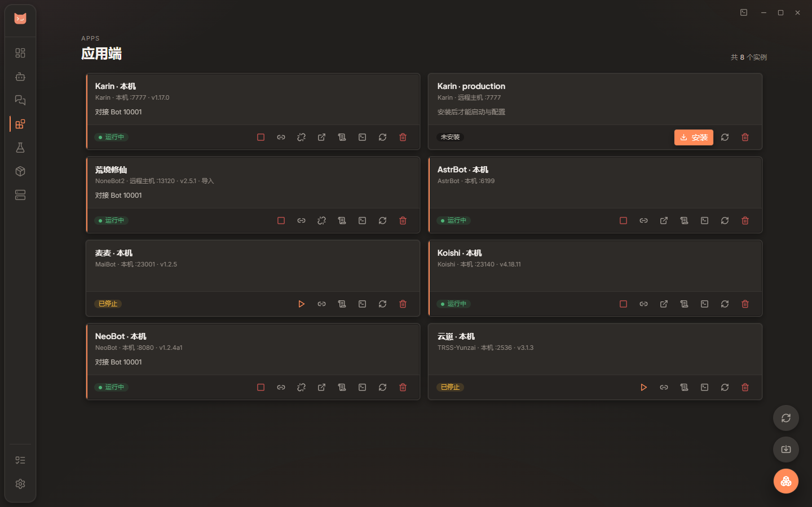

# 应用端实例

[返回用户指南](README.md) · [远端部署](remote-linux.md)

NapCat / SnowLuma 负责 QQ 协议连接，应用端负责插件、指令或 AI 对话。Desktop 把它们分成「机器人」与「应用端」管理，通过 OneBot 连接对接。

## 创建或导入实例

1. 在「组件」页选择本机或远端主机，找到需要的应用框架，点击新建实例；也可从「应用端」页新建。
2. 选择框架、安装位置与主机，按任务提示安装依赖和框架。
3. 已有项目可从应用端入口导入，由 Desktop 识别目录和配置。
4. 安装完成后，在「应用端」页打开实例详情，编辑配置，再启动并查看日志。

实例各自管理依赖和安装目录；同一框架可以创建多个实例。「随桌面端启动」按实例设置，新建实例默认关闭。

图中使用浏览器演示数据。

## 支持的框架

| 框架                | 可从详情中管理                             |
| :------------------ | :----------------------------------------- |
| Karin               | 配置、插件与连接                           |
| NoneBot2            | 适配器、插件与连接配置                     |
| AstrBot             | 模型提供商、人格、知识库、会话与插件配置   |
| MaiBot（麦麦）      | 深度配置、模型、提示词、学习数据与试聊     |
| Koishi              | 配置表单、插件树与连接                     |
| TRSS-Yunzai（云崽） | 实例、配置与 OneBot 对接                   |
| NeoBot              | 配置、模型、提示词、记忆、插件、运行与用量 |

各框架提供的页面不同。运行期数据和部分配置需要实例已启动，且 Desktop 能连接其 WebUI / Dashboard；旧框架版本缺少接口时，按页面提示升级或使用上游入口。

## 对接 Bot

1. 在实例卡片或详情里打开「对接」，选择已配置的 Bot。
2. 检查界面提供的连接方向与主机组合，确认后保存。
3. 启动应用端和 Bot，查看连接状态、双方日志；应用端有 WebUI 时，也可检查其适配器状态。

Desktop 会按框架能力配置正向或反向 WebSocket，支持原生和 Docker Bot，以及不同服务器之间的组合。Docker 正向连接使用宿主机实际发布的端口；反向连接通过只监听 Docker 网桥地址的 SSH 转发访问宿主机回环端口，无需公开到 `0.0.0.0`。

| 主机组合 | 隧道与桌面端要求 |
| :--- | :--- |
| 同一主机 | 原生直接连接；Docker 反向连接自动建立主机常驻网桥转发 |
| 本机与远端 | 自动建立 Desktop 管理的 SSH 隧道，Desktop 必须在线 |
| 两台不同远端 | 自动配置主机常驻 SSH 隧道，退出 Desktop 后仍可继续运行 |

常驻隧道使用单独生成、只允许指定转发目标的 SSH 密钥，私钥保留在运行隧道的主机。Docker 反向对接需要宿主机可以通过 SSH 连接自身；缺少 SSH 工具、认证或转发权限时会报告具体错误。主机重启后，重新连接 Desktop 会检查并恢复隧道。预览只展示连接计划，应用时才建立并核验转发。

不要把本机的 `127.0.0.1` 直接填给另一台主机上的服务；一键对接会自动填写可达地址。解绑会清理相应的连接和托管转发。

## 编辑与备份

- 有表单的配置可以直接填写，原文入口用于保留自定义字段和格式；保存冲突时先核对另一侧的改动。
- 插件和模型配置按框架能力提供。保存配置不等于安装插件程序，运行期操作需要框架服务可用。
- 配置 ZIP 可以保存实例档案和框架配置；程序、插件、数据库与系统凭据需另行备份。恢复到其他机器前，核对主机和安装路径。

完整备份边界见 [备份与恢复配置](README.md#备份与恢复配置)。

## 启动或对接失败

先看安装任务和实例日志，确认运行时、依赖、安装目录与端口；再看 Bot 是否在线、连接方向与地址是否一致。远端实例还需确认 SSH 能连接，相关隧道可用。不要只看「进程运行中」，应用端与 QQ 的连接也需要成功。
