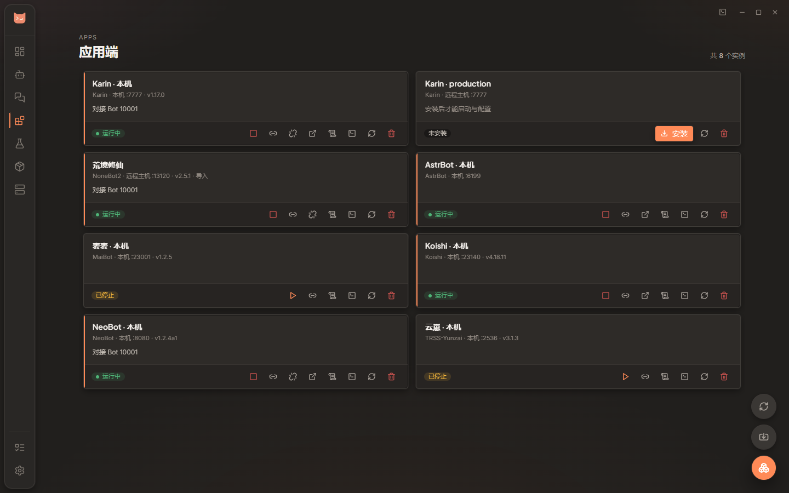

# 应用端实例

[返回用户指南](README.md) · [远端部署](remote-linux.md)

NapCat / SnowLuma 负责 QQ 协议连接，应用端负责插件、指令或 AI 对话。Desktop 把它们分成「机器人」与「应用端」管理，通过 OneBot 连接对接。

## 创建或导入实例

1. 在「组件」页选择本机或远端主机，找到需要的应用框架，点击新建实例；也可从「应用端」页新建。
2. 选择框架、安装位置与主机，按任务提示安装依赖和框架。
3. 已有项目可从应用端入口导入，由 Desktop 识别目录和配置。
4. 安装完成后，在「应用端」页打开实例详情，直接编辑配置文件；支持 WebUI 的框架启动后也可点击「打开 WebUI」。

实例各自管理依赖和安装目录；同一框架可以创建多个实例。「随桌面端启动」按实例设置，新建实例默认关闭。

图中使用浏览器演示数据。

## 支持的框架

| 框架 | 配置入口 |
| :--- | :--- |
| Karin、AstrBot、MaiBot（麦麦）、Koishi、NeoBot | 配置文件编辑器；启动后也可「打开 WebUI」 |
| NoneBot2、TRSS-Yunzai（云崽） | 配置文件编辑器 |

Desktop 提供配置文件、日志与受支持的版本切换。框架的模型、插件和业务管理页面使用其 WebUI；远端入口会自动建立 SSH 隧道。登录所需的密钥会复制到剪贴板，账号密码类框架可从「更多 → WebUI 账号」查看账号。

## 对接 Bot

1. 在实例详情点击「一键对接」（已绑定时为「改绑 Bot」），或使用卡片上的对接入口，选择已配置的 Bot。
2. 检查界面提供的连接方向与主机组合，确认后保存。
3. 启动应用端和 Bot，查看连接状态、双方日志；应用端有 WebUI 时，也可检查其适配器状态。

Desktop 会按框架能力配置正向或反向 WebSocket，支持原生和 Docker Bot，以及不同服务器之间的组合。Docker 正向连接使用宿主机实际发布的端口；反向连接通过只监听 Docker 网桥地址的 SSH 转发访问宿主机回环端口，无需公开到 `0.0.0.0`。

| 主机组合 | 隧道与桌面端要求 |
| :--- | :--- |
| 同一主机 | 原生直接连接；Docker 反向连接自动建立主机常驻网桥转发 |
| 本机与远端 | 自动建立 Desktop 管理的 SSH 隧道，Desktop 必须在线 |
| 两台不同远端 | 自动配置主机常驻 SSH 隧道，退出 Desktop 后仍可继续运行 |

常驻隧道使用单独生成、只允许指定转发目标的 SSH 密钥，私钥保留在运行隧道的主机。Docker 反向对接需要宿主机可以通过 SSH 连接自身；缺少 SSH 工具、认证或转发权限时会报告具体错误。主机重启后，重新连接 Desktop 会检查并恢复隧道。预览只展示连接计划，应用时才建立并核验转发。

不要把本机的 `127.0.0.1` 直接填给另一台主机上的服务；一键对接会自动填写可达地址。解绑会清理相应的连接和托管转发。

## 配置与备份

- 打开任意框架实例后，默认显示配置文件编辑器。选择文件后编辑并保存；切换文件、返回列表时会保留本次打开 Desktop 期间的未保存草稿。
- 保存会检查 JSON、TOML、YAML 语法和文件版本。外部修改会触发冲突提示，可重新加载或明确选择覆盖；读取失败不会丢弃草稿。
- 保存原文不会自动改写其他配置或重新对接。修改连接地址或端口后，需要同步协议端，或重新使用「一键对接」。不支持热加载的文件需重启生效；Koishi 的主配置需停止实例后保存。
- 一键对接只写连接所需字段，保留写入前备份与失败回滚。
- 配置 ZIP 可以保存实例档案和框架配置；程序、插件、数据库与系统凭据需另行备份。恢复到其他机器前，核对主机和安装路径。

完整备份边界见 [备份与恢复配置](README.md#备份与恢复配置)。

### 保存后何时生效

保存成功会显示全局 InfoBar。实例停止时提示下次启动生效；运行时按文件提示自动重载、重启要求或手动重载入口。自动重载是否成功以框架日志为准，Desktop 不代调框架业务接口。

| 框架 | 配置文件原文保存后的行为 |
| :--- | :--- |
| Karin | `.env`、config / adapter / groups / privates / render JSON 支持文件监听；`.env` 中 HTTP 地址、端口等启动项仍需重启，Redis 连接配置按重启处理。[上游实现](https://github.com/KarinJS/Karin/tree/main/packages/core/src/utils/config/file) |
| MaiBot | 主配置和模型配置由文件监听器自动重载，适配器配置由插件运行时处理；主配置中的监听地址、端口及其他启动项需重启。[配置说明](https://docs.maibot.chat/manual/configuration/) |
| TRSS-Yunzai | bot / other / group / renderer 配置支持文件监听；关闭 `file_watch` 时不会自动重载。server / redis / db / milky / satori 涉及运行中连接，按重启处理。[配置监听](https://github.com/TimeRainStarSky/Yunzai/blob/main/lib/config/config.js) |
| NeoBot | 主配置需执行 `/reload` 或重启；原文写盘本身不会触发重载。面板权限等部分设置按请求重读，地址和端口需重启。[配置链路](https://github.com/SuperQuail/NeoBot/blob/main/docs/flow/01b-config-system.md) |
| NoneBot2、AstrBot | 当前原文编辑入口按重启生效处理；WebUI 的保存行为不等于直接改文件。 |
| Koishi | 主配置先停止实例再保存；再次启动生效。[上游配置说明](https://koishi.chat/zh-TW/guide/develop/config) |

## 启动或对接失败

先看安装任务和实例日志，确认运行时、依赖、安装目录与端口；再看 Bot 是否在线、连接方向与地址是否一致。远端实例还需确认 SSH 能连接，相关隧道可用。不要只看「进程运行中」，应用端与 QQ 的连接也需要成功。
