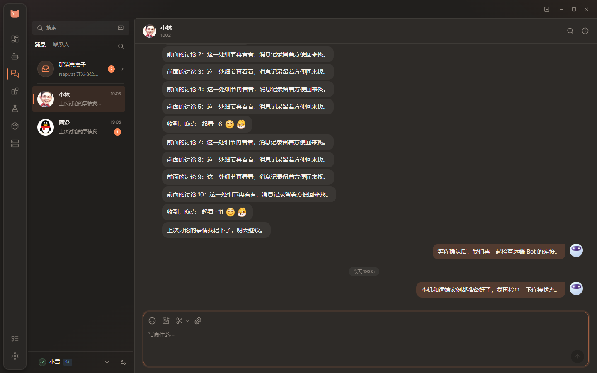

# 聊天与截图

[返回用户指南](README.md) · [项目首页](../../README.md)

## 开始聊天

1. 启动 Bot 并完成 QQ 登录。
2. 打开侧栏「聊天」，从左下角选择账号；在账号设置中确认「用于聊天」已开启。
3. 选择最近会话，或从「联系人」发起私聊 / 群聊。好友可以按 QQ 原有分组筛选，群聊收在群消息盒子里。

每个 Bot 的联系人、会话、草稿和消息分开管理。聊天可以留在主窗口，也可以打开独立窗口，当前草稿和会话会随窗口交接。

图中使用浏览器演示数据。

## 消息与附件

| 操作                      | 用法                                                                   |
| :------------------------ | :--------------------------------------------------------------------- |
| 回复、复制、@、撤回与转发 | 在消息上打开右键菜单；撤回和转发受协议端能力与权限限制                 |
| 发图片或文件              | 使用输入框工具栏，或把附件拖入 / 粘贴到输入框，一次最多 8 个           |
| 发送失败                  | 查看消息旁的失败原因后重试；可取消的发送任务会显示取消入口             |
| 查找消息                  | 点击搜索入口，可查当前会话或本账号已保存记录，按类型、发送者与日期筛选 |
| 查看媒体                  | 点击图片查看大图；语音、视频、Markdown 和转发记录按消息类型显示        |
| 防撤回                    | 在账号设置中按需开启，默认关闭；只保留本机已收到的内容                 |

近期聊天记录会保存在本机，并有条数与容量上限；它不是完整的云端聊天记录备份。本账号搜索只查已保存的记录，不会自动拉取所有会话历史。草稿在退出程序后清掉，消息记录不随配置 ZIP 导出。

语音条支持播放 / 暂停、拖动进度、查看时长、调整音量和倍速。首次播放会先加载音频；加载失败时可重试。协议端支持时还可以转文字。

## 群文件

进入群聊后打开群文件入口，可以浏览目录、搜索文件、上传和下载。有权限且协议端支持时，还能新建目录、重命名、移动和删除，并查看容量。

好友或群聊消息中的文件卡片也能直接下载。下载时优先向协议端获取新链接，旧版本无法获取时尝试消息自带链接；已过期的文件仍需发送者重新发送。传输任务支持进度与取消；关闭群文件面板不会中断已开始的传输。不支持或无权限的操作会置灰。

## 截图与滚动长截图

默认使用 `Ctrl+Alt+S`，也可点输入框的截图按钮。

1. 框选区域后，按需标注、撤销或重做。
2. 需要长图时进入滚动截图，手动上下滚动内容，查看拼接预览；可暂停、撤销最近一次采集。
3. 完成后复制或保存；启用「截图后添加到聊天框」时，结果进入草稿，确认后再发送。

在截图按钮旁打开设置，可以修改快捷键、选择全局或仅程序有焦点时响应，以及是否在截图时隐藏聊天窗口。

「截图后添加到聊天框」默认开启。关闭后仍可复制和保存，完成时不插入聊天附件，也不拉起聊天窗口。全局快捷键在聊天页未打开时也能使用；截图窗口被挡住时，再按一次快捷键可召回当前截图。

## 后台接收与账号托盘

在账号设置里按需开启「后台接收」和头像托盘入口，两项默认关闭。新消息可显示红点或头像闪烁，鼠标悬停查看未读会话，点击进入对应会话。群聊可以单独设免打扰。

不用聊天时，在「设置 → 功能」关闭「聊天」。聊天窗口、后台接收、账号托盘和截图快捷键会一起停止，已有记录与账号设置保留。

## 常见问题

- **看不到账号或没有实时消息**：先确认 Bot 已运行、QQ 已登录、账号允许用于聊天，再检查账号连接状态和 Bot 日志。
- **媒体或群文件操作不可用**：检查协议端版本与账号权限。调试台能提供接口错误细节，但浏览器演示不能验证真实传输。
- **快捷键没有响应**：检查聊天功能开关、快捷键作用范围，以及是否与其他程序冲突；可先用输入框截图按钮确认截图入口。
